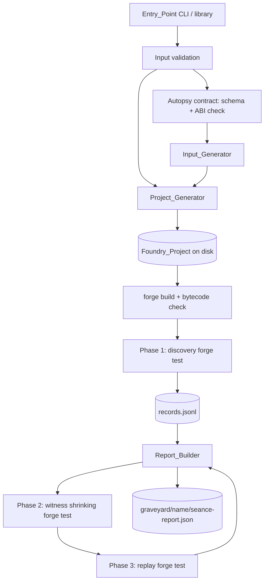
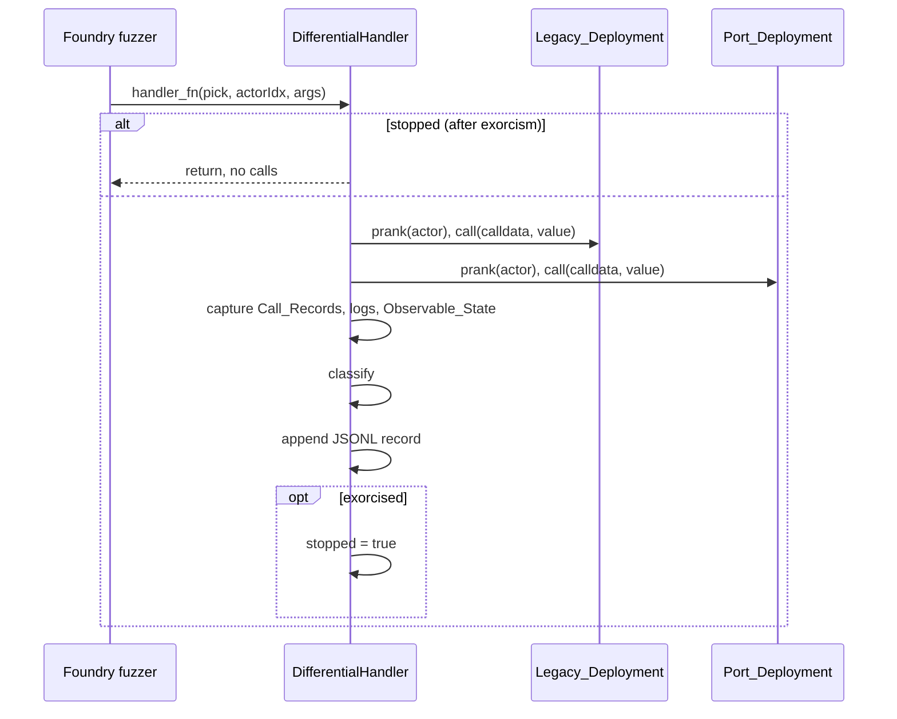

# Design Document

## Overview

The Séance_Engine lives in `engine/` and is the fourth stage of Exhume. For one legacy pre-0.8 contract and its deterministic 0.8 port, it generates a Foundry project, runs `forge`, and produces a JSON Séance_Report under `graveyard/<name>/`.

The design splits the work into two halves.

- **TypeScript half (pure, property-testable).** Autopsy input validation, targeted input generation, Foundry project generation, classification, report building, and entry-point input validation. All of this is deterministic and runs in-process under vitest and fast-check.
- **Solidity half (generated, run by Foundry).** A generated `DifferentialHandler` deploys both bytecodes, sends identical calls, captures Call_Records, and appends one JSON line per call to a record file. A small `Classifier.sol` library mirrors the TypeScript classifier.

Key design decisions:

1. **Records, not invariant failures, drive counting.** Foundry stops an invariant campaign at the first failing invariant, which would truncate the call counts. The discovery phase therefore runs with invariants that never fail and with `invariant.shrink_run_limit = 0`. The handler writes one JSONL record per call via `vm.writeLine`. The engine derives counts, divergences, and the BEC "within 2,000 calls" measurement from those records.
2. **Shrinking is a second phase.** For each unique (function, Classification) pair found for `exorcised` and `port-bug`, the engine generates a witness invariant that fails when the handler sees that pair. It runs `forge test` with Foundry's default shrinking and recording disabled (`SEANCE_RECORD=0`), which satisfies Requirement 8.1 without double-counting shrink replays. The engine then replays the shrunk sequence in a generated replay test on fresh deployments (Requirement 8.2).
3. **Fresh state per sequence comes from Foundry.** Foundry reverts to the `setUp` snapshot at the start of every invariant run, so each sequence starts with fresh deployments (Requirement 5.4). A record with `idx == 0` marks a new sequence.
4. **Classification has one specification and two implementations.** `classify` in TypeScript is the oracle and the report-side validator. `Classifier.sol` is the on-chain copy. A shared table of vectors in `engine/test/vectors/classification.json` is run against both (vitest and `forge test`).
5. **Event logs are compared at log level** with the emitter normalised to a `SELF` sentinel, so `emit` versus a legacy bare event call is irrelevant, and a dropped `emit` is a port bug.
6. **Legacy bytecode is loaded with `vm.deployCode`.** The Legacy_Artifact path is pinned via `compilation_restrictions`. The port is deployed from its creation code with the same ABI-encoded constructor arguments.

Research notes (Foundry behaviour this design relies on, from Foundry docs): `compilation_restrictions` in `foundry.toml` pins a file path to a solc version range, `vm.deployCode(path, args)` deploys an artifact by path, `vm.recordLogs`/`vm.getRecordedLogs` capture logs per call, `vm.writeLine` requires `fs_permissions`, and invariant failures are shrunk by default, bounded by `shrink_run_limit`. These are the assumptions the integration tests (Docker image) verify.

## Architecture





Repository placement:

```
engine/src/seance/
  entry.ts            # Entry_Point (CLI + library)
  inputs.ts           # entry input validation
  autopsy-contract.ts # schema validation, ABI cross-check
  input-generator.ts  # Targeted_Values
  project-generator.ts
  templates/          # Handler.sol, Classifier.sol, invariant test templates
  classify.ts
  report.ts           # build, validate, canonical serialize
  runner.ts           # forge process control, timeout
  schemas/            # autopsy-v1.schema.json, seance-report.schema.json
engine/test/seance/   # vitest + fast-check, forge tests for templates
graveyard/<name>/     # source, metadata, on-chain runtime code, seance-report.json
```

## Components and Interfaces

### Entry_Point (`entry.ts`)

```ts
export interface SeanceInput {
  contractName: string;            // 1..128 chars
  legacySource: string;            // non-empty, <= 1 MiB
  portSource: string;              // non-empty, <= 1 MiB
  autopsyReport: string;           // raw JSON text, <= 10 MB
  legacySolcVersion: string;       // 0.x.y, < 0.8.0
  legacyOptimizer: boolean;
  legacyOptimizerRuns?: number;    // 0..4294967295, required only when optimizer enabled
  onChainRuntimeCode: string;      // 0x hex
  constructorArgs?: string;        // ABI-encoded hex, default "0x"
  fuzzSeed?: string;
  timeoutSeconds?: number;         // default 300
}

export type SeanceError = { code: string; message: string; details?: unknown;
  partialCounts?: ClassificationCounts };

export function runSeance(input: unknown, opts?: RunOptions): Promise<SeanceReport>; // rejects with SeanceError
```

The CLI wraps `runSeance`, prints the report or the structured error as JSON, and exits 0 on success and non-zero on any error. The Worker later calls `runSeance` unchanged.

Error codes: `MISSING_INPUT`, `INVALID_INPUT`, `AUTOPSY_REJECTED`, `SOLC_MISSING`, `BUILD_FAILED`, `BYTECODE_MISMATCH`, `TIMEOUT`, `REPORT_WRITE_FAILED`, `SEANCE_FAILED`.

### Input validation (`inputs.ts`)

`validateInput(raw): Result<SeanceInput, SeanceError>` collects every missing field (`MISSING_INPUT`) or every invalid field (`INVALID_INPUT`) in a single error. It also enforces the solc version rule (`/^0\.\d+\.\d+$/` and minor below 8) and the optimizer runs range. The Project_Generator reuses it so it never writes files for invalid inputs.

### Autopsy contract (`autopsy-contract.ts`)

```ts
export function parseAutopsyReport(text: string, legacyAbi: AbiFunction[]): Result<AutopsyReport, SeanceError>;
export function serializeAutopsyReport(r: AutopsyReport): string; // canonical key order
```

Check order, matching Requirement 11: size/empty/JSON parse, then `schemaVersion` present, then supported, then JSON-schema validation (all violations listed with JSON pointers, via Ajv with `allErrors`), then ABI function cross-check (all unknown function names listed). Supported versions: `["1"]`.

### Input_Generator (`input-generator.ts`)

Pure, `bigint` based.

```ts
export function generateTargets(report: AutopsyReport, abi: AbiFunction[]): TargetPlan;

export interface TargetPlan {
  sites: SiteTargets[];          // one entry per Arithmetic_Site
  seedSequences: SeedCall[][];   // each at most 10 calls
}
export interface SiteTargets {
  siteId: string;
  functionName: string;
  values: TargetedValue[];       // 1..64
  unreachable: boolean;
}
export type TargetedValue =
  | { kind: "single"; param: ParamSlot; value: bigint }
  | { kind: "pair"; params: [ParamSlot, ParamSlot]; values: [bigint, bigint] }
  | { kind: "arrayLenTimesValue"; arrayParam: ParamSlot; valueParam: ParamSlot; length: number; value: bigint };
export interface ParamSlot { paramIndex: number; headOffset: number; } // ABI head position
```

Rules (`M = 2^N`, `N` = bit width of the narrowest operand type):

| Site form | Values produced |
|---|---|
| `x * k`, known `k > 1` | `x` in `[ceil(M/k)-2, ceil(M/k)+2]`, clamped to `[0, M-1]`, at most 5 |
| `a + b`, known `a` | `b` in `[M-1-a-2, M-1-a+2]`, clamped |
| `a - b`, known `a` | `b` in `[a-2, a+2]`, clamped |
| `x * y`, both unknown | pairs `(2^i, 2^(N-i))` with `i` chosen deterministically, always including `(2^(N/2), 2^(N/2))`, at most 64 |
| `x ** y` | pairs `(b, e)` with `b^e >= M` such as `(2, N)`, `(2, N+1)`, `(3, ceil(N/log2 3))`, at most 64 |
| array length `n` times value | for `n` in 2..24, `(n, ceil(M/n))` |

`ParamSlot.headOffset` is `4 + 32 * paramIndex` for static head slots, which is how a value is mapped to its calldata position (Requirement 6.7). Seed sequences come from the Autopsy site's precondition hints (constructor-set balance, `approve`, prior `transfer`); a site with no resolvable seed is flagged `unreachable: true` and still gets values (Requirements 6.10 to 6.12).

### Project_Generator (`project-generator.ts`)

```ts
export function generateProject(input: SeanceInput, plan: TargetPlan, abi: AbiFunction[]): ProjectFiles;
// ProjectFiles = Array<{ path: string; contents: string }> sorted by path, LF newlines, no timestamps
export function writeProject(dir: string, files: ProjectFiles): Promise<void>; // atomic: validate first, then write
```

The generator is a pure function with no clocks, randomness, or environment reads, so identical inputs give byte-identical files (Requirement 1.13). Output layout:

```
foundry.toml
src/legacy/<Name>.sol          # pinned to legacy solc
src/port/<Name>.sol            # solc 0.8.x
test/handler/DifferentialHandler.sol
test/handler/Classifier.sol
test/Seance.t.sol              # discovery invariants (never fail)
test/Witness.t.sol             # generated per (function, class) in phase 2
test/Replay.t.sol              # generated per shrunk sequence in phase 3
test/handler/Targets.sol       # Targeted_Values as constants
```

`foundry.toml` carries a top-level port profile (`solc = "0.8.x"`), `compilation_restrictions` entries for every legacy source file (`paths`, `version = "=<legacy>"`), the optimizer settings for the legacy file only (a per-file `additional_compiler_profiles` entry, omitting `optimizer_runs` when disabled), `fs_permissions` limited to the `seance-out/` directory, and `[invariant]` settings (`fail_on_revert = false`, `shrink_run_limit = 0` for discovery).

### DifferentialHandler (generated Solidity)

- `setUp` deploys the legacy contract with `vm.deployCode("out/<Name>.sol/<Name>.json", ctorArgs)` and the port with `create` over `abi.encodePacked(type(Port).creationCode, ctorArgs)`, both under `vm.startPrank(DEPLOYER)`, funds both with the same wei, and runs the seed sequences through the same differential path.
- If the constructors differ in outcome, or both revert, the handler writes a constructor record (`port-bug`, or `match`/`reason-modernised`) and sets `stopped`.
- One handler function per `nonpayable`/`payable` non-constructor ABI function, plus `handler_fallback_empty` and `handler_fallback_unknown` when the ABI has a `fallback`. Each takes `(uint256 pick, uint8 actorIdx, <fuzz params>)`.
- `_pickValue(pick, targets, fuzzValue)` returns a target when `pick % 2 == 0` and `targets.length > 0`, which gives a probability of at least 50 percent.
- `_differential(selector, calldata, value)` does: `vm.prank(actor)`, `vm.recordLogs()`, low-level call to legacy, collect logs; same for the port with the same `vm.warp`/`vm.roll` values; builds two `CallRecord`s; reads `ObservableState` from both; calls `Classifier.classify`; writes the JSONL record when `SEANCE_RECORD != 0`; sets `stopped = true` on `exorcised`.
- `ObservableState` = `balance`, return data, normalised logs, all no-argument `view`/`pure` returns, and every one-address and two-address public mapping getter over the Actor_Set (so `allowed(owner, spender)` is covered, Requirement 10.4).
- Reverted calls get an empty log list (Requirement 3.11).

### Classifier (`classify.ts`, `Classifier.sol`)

```ts
export type Classification = "match" | "reason-modernised" | "exorcised" | "port-bug";
export interface CallRecord { success: boolean; data: string; logs: NormLog[]; state: ObservableState }
export function classify(legacy: CallRecord | undefined, port: CallRecord | undefined):
  { classification: Classification; invalidRecord: boolean; differingFields: string[] };
export function classifyConstructors(l: CtorOutcome, p: CtorOutcome): Classification;
```

Decision table:

| Legacy | Port | Condition | Result |
|---|---|---|---|
| missing or malformed | any | | `port-bug`, `invalidRecord` |
| revert | revert | data identical | `match` |
| revert | revert | data differs (including empty vs non-empty) | `reason-modernised` |
| success | revert | data equals `Panic(0x11)` encoding exactly | `exorcised` |
| success | revert | other data | `port-bug` |
| revert | success | | `port-bug` |
| success | success | return data, logs, and state all equal | `match` |
| success | success | any difference | `port-bug`, with `differingFields` |

`Panic(0x11)` encoding is `0x4e487b71` followed by the 32-byte word `0x11`, 36 bytes in total.

### Report_Builder (`report.ts`)

```ts
export function buildReport(records: RecordLine[], meta: ReportMeta, shrunk: ShrunkResults): SeanceReport;
export function validateReport(r: unknown): Result<SeanceReport, SchemaViolation[]>;
export function serializeReport(r: SeanceReport): string;   // canonical key order, 2-space indent, trailing LF
export function parseReport(text: string): SeanceReport;
export function writeReportAtomic(path: string, text: string): Promise<void>; // temp file + rename
```

Behaviour:

- Groups records by sequence (an `idx == 0` record starts a sequence) and ignores any record after an `exorcised` record in the same sequence (Requirement 5.3), recording `exorcisedAtIndex`.
- Counts every Classification, with zero for absent ones.
- Reports exactly one sequence per (function, Classification) pair for `exorcised` and `port-bug` (Requirement 8.4), choosing the first by global call ordinal.
- `chooseReported(original, shrunk, replayClass)` returns the shrunk sequence only if `replayClass` equals the original Classification, otherwise the original, flagged `unshrunk: true`.
- Attributes an Arithmetic_Site to an Exorcism when the exorcised call's function has exactly one site whose Targeted_Value appears in the calldata at the site's `ParamSlot`, else `siteAttribution: "unattributed"`.
- Writes via temp file and rename so a write failure leaves any existing report unchanged (Requirement 7.2).

### Runner (`runner.ts`)

Spawns `forge` with `child_process.spawn`, streams output, and enforces the timeout (default 300 s). On timeout it sends SIGTERM and then SIGKILL so that `forge` stops within 5 seconds, then counts the records written so far and returns a `TIMEOUT` error with `partialCounts`. Before `forge build` it checks that the legacy solc binary exists (`solc` list from the Foundry svm directory); a missing version yields `SOLC_MISSING` without building. The bytecode check strips the Metadata_Suffix (the CBOR section whose length is given by the last two bytes) from both runtime codes and compares the rest.

### BEC acceptance runner

`engine/src/seance/acceptance.ts` wraps `runSeance` and checks Requirement 9 and 10 conditions (exorcism in `batchTransfer`, zero port bugs, first exorcism ordinal at most 2,000, `_receivers` length 2..20, replay confirms). It never overwrites `graveyard/bec/seance-report.json` on failure and returns the failing condition. The mutation variants (Planted_Port_Bug, Dropped_Emit_Mutation) are test-only ports produced by string-level edits in test fixtures, and must produce at least one `port-bug`.

## Data Models

### Autopsy_Report (schema v1)

```ts
interface AutopsyReport {
  schemaVersion: "1";
  contract: string;
  sites: ArithmeticSite[];
}
interface ArithmeticSite {
  id: string;
  function: string;
  operator: "+" | "-" | "*" | "**";
  operands: [Operand, Operand];
  location: { file: string; line: number; column: number };
  precondition?: { kind: "constructor-balance" | "approve" | "transfer"; hint?: string }[];
}
type Operand =
  | { kind: "known"; value: string /* decimal */; type: string }
  | { kind: "param"; name: string; type: string }
  | { kind: "arrayLength"; name: string; type: string }
  | { kind: "unknown"; type: string };
```

### Record line (JSONL, one per call)

```ts
interface RecordLine {
  ordinal: number;               // global, 1-based, per forge process
  idx: number;                   // position in sequence, 0-based; -1 for constructor/seed records
  function: string;
  selector: string;
  calldata: string;
  sender: string;
  value: string;                 // decimal wei
  legacy: CallRecordWire;
  port: CallRecordWire;
  classification: Classification;
  differingFields: string[];
  invalidRecord: boolean;
}
interface CallRecordWire { success: boolean; data: string; logs: NormLog[]; stateHash: string; stateFields?: Record<string,string> }
interface NormLog { emitter: "SELF" | string; topics: string[]; data: string }
```

`stateFields` is written only for records classified `port-bug`, to keep the file small.

### Séance_Report

```ts
interface SeanceReport {
  schemaVersion: "1";
  contract: string;
  seed: string;
  runs: number;
  totalCalls: number;
  counts: { match: number; "reason-modernised": number; exorcised: number; "port-bug": number };
  exorcisms: Finding[];
  portBugs: Finding[];
  sequenceResults: { total: number; endedExorcised: number; exorcisedAtIndex: number[] };
  unreachableSites: string[];
}
interface Finding {
  function: string;
  classification: "exorcised" | "port-bug";
  calldata: string;              // shrunk, hex
  sender: string;
  value: string;                 // decimal wei
  precedingCalls: { function: string; calldata: string; sender: string; value: string }[];
  unshrunk?: true;
  site?: { id: string; location: { file: string; line: number; column: number } } | "unattributed";
  legacy?: CallRecordWire;       // port bugs only
  port?: CallRecordWire;         // port bugs only
  differingFields?: string[];
}
```

Invariants: the four counts sum to `totalCalls`; keys are serialized in a fixed order; numbers that exceed 2^53 are decimal strings.

## Correctness Properties

*A property is a characteristic or behavior that should hold true across all valid executions of a system-essentially, a formal statement about what the system should do. Properties serve as the bridge between human-readable specifications and machine-verifiable correctness guarantees.*

### Property 1: Project generation is deterministic

*For any* valid séance input and target plan, generating the Foundry_Project twice produces the same set of relative paths with byte-identical contents.

**Validates: Requirements 1.13**

### Property 2: Generated foundry.toml pins legacy files and settings

*For any* valid séance input, the generated `foundry.toml` contains a Compilation_Restriction for every legacy source file with exactly the legacy solc version and no other version, sets the port solc to a 0.8.x version, and sets the legacy optimizer to enabled with the given runs value (0 to 4,294,967,295) when enabled, or to disabled with no runs value when disabled. The generated file set always includes `foundry.toml`, the legacy source, the port source, the handler, and the invariant test.

**Validates: Requirements 1.1, 1.2, 1.3, 1.4, 1.5**

### Property 3: Input validation names every bad input and writes nothing

*For any* séance input in which a non-empty subset of fields is missing, or a non-empty subset is invalid (empty or over-length contract name, non-boolean optimizer, empty or over-1 MiB source, solc version not a 0.x.y below 0.8.0), validation returns an error whose message names exactly that subset, and the generator and Entry_Point start no run and write no files.

**Validates: Requirements 1.12, 12.4, 12.5**

### Property 4: Runtime bytecode comparison ignores only the metadata suffix

*For any* runtime code body and any two Metadata_Suffix values, the comparison reports equal, and *for any* two bodies that differ in at least one byte, it reports a mismatch.

**Validates: Requirements 1.8**

### Property 5: Handler coverage matches the ABI

*For any* ABI, the generated handler exposes exactly one handler function for each non-constructor function with `nonpayable` or `payable` mutability, and the observable-state reader includes every no-argument `view`/`pure` function and every address-keyed public mapping getter for each ordered pair of Actor_Set addresses.

**Validates: Requirements 3.3, 10.4**

### Property 6: Log normalisation and comparison

*For any* two lists of raw logs in which the emitters equal the respective deployment address where they correspond, are otherwise identical, and have equal topics, data, and order, the normalised lists are equal. *For any* pair that differs in count, order, topics, data, or in a non-self emitter, the normalised lists are unequal. *For any* reverted call, the normalised log list is empty.

**Validates: Requirements 3.9, 3.10, 3.11**

### Property 7: Classification follows the decision table

*For any* pair of well-formed Call_Records, `classify` returns exactly one Classification, equal to the table oracle: both revert with identical data gives `match`; both revert with any differing byte (including empty versus non-empty) gives `reason-modernised`; legacy success and port revert data exactly equal to the 36-byte `Panic(0x11)` encoding gives `exorcised`; legacy success and any other port revert gives `port-bug`; legacy revert and port success gives `port-bug`; both succeed with equal return data, logs, and Observable_State gives `match`; both succeed with any difference (including a single `allowed` value) gives `port-bug` and lists the differing fields.

**Validates: Requirements 3.4, 3.8, 4.1, 4.2, 4.3, 4.4, 4.5, 4.6, 4.7, 4.8, 10.5**

### Property 8: Classification is pure and rejects malformed records

*For any* pair of Call_Records, calling `classify` twice returns equal results and leaves the inputs unmodified. *For any* pair in which a record is missing, malformed, or lacks a success or revert outcome, the result is `port-bug` with `invalidRecord` set.

**Validates: Requirements 4.9, 4.10**

### Property 9: Constructor outcome classification

*For any* pair of constructor outcomes, `classifyConstructors` returns `port-bug` when exactly one reverts, `match` when both revert with identical data, `reason-modernised` when both revert with differing data, and the séance ends without further calls in each of these three cases.

**Validates: Requirements 2.6, 2.7**

### Property 10: Exorcism truncates a sequence

*For any* stream of record lines containing sequences, the Report_Builder ends each sequence at its first `exorcised` record, counts and reports nothing after it in that sequence, records the index of the exorcised call and the prefix up to and including it in call order, marks the sequence as ending in an exorcised result, and keeps counting after `port-bug` and `reason-modernised` records. Sequences that start after the exorcism are unaffected.

**Validates: Requirements 5.1, 5.2, 5.3, 5.5, 5.6**

### Property 11: Multiplication targets overflow and wrap

*For any* bit width `N` in {8, 16, ..., 256} and any known factor `k > 1` with `k < 2^N`, the values produced for `x * k` are the clamped integers in `[ceil(M/k)-2, ceil(M/k)+2]` (at most 5, with `M = 2^N`), include `floor(M/k)` and `ceil(M/k)`, and at least one of them satisfies `x * k >= M` with `(x * k) mod M < k`.

**Validates: Requirements 6.2, 6.6, 6.13**

### Property 12: Addition and subtraction targets are windows around the boundary

*For any* bit width `N` and known operand `a` in `[0, M-1]`, the values for `a + b` are exactly the clamped integers in `[M-1-a-2, M-1-a+2]`, and the values for `a - b` are exactly the clamped integers in `[a-2, a+2]`, all within `[0, M-1]`.

**Validates: Requirements 6.3, 6.4, 6.6**

### Property 13: Unknown-operand multiplication pairs overflow and wrap

*For any* bit width `N` (even), the pairs produced for `x * y` with both operands unknown number between 1 and 64, include `(2^(N/2), 2^(N/2))`, and each pair satisfies `x * y >= M` and `(x * y) mod M < min(x, y)`.

**Validates: Requirements 6.5, 6.6**

### Property 14: Array length times value pairs overflow and wrap

*For any* bit width `N` and any array length `n` from 2 to 24, the generator produces the pair `(n, ceil(M/n))`, and each produced pair satisfies `n * value >= M` and `(n * value) mod M < n`.

**Validates: Requirements 6.8, 6.14**

### Property 15: Every site gets bounded values, mapped to calldata slots

*For any* valid Autopsy_Report, every Arithmetic_Site has between 1 and 64 Targeted_Values, each value's `ParamSlot.headOffset` equals `4 + 32 * paramIndex` for its parameter, every seed sequence has at most 10 calls, and a site with no resolvable seed is flagged unreachable while still receiving values. An empty report yields an empty plan.

**Validates: Requirements 6.1, 6.7, 6.10, 6.11, 6.12**

### Property 16: Autopsy report round trip

*For any* valid Autopsy_Report, `parse(serialize(r))` deeply equals `r`, and serializing the parsed value yields a document equal to the first serialization.

**Validates: Requirements 11.9**

### Property 17: Autopsy rejection is ordered and exhaustive

*For any* Autopsy_Report text, the engine checks emptiness, size, and JSON syntax first, then `schemaVersion`. A missing or unsupported version produces an error naming it, and no schema errors are reported in that case. For a supported version it reports every schema violation with its location, then every function name absent from the ABI. A valid report yields every site available to the generator. In every rejection case, no séance inputs are generated.

**Validates: Requirements 11.2, 11.3, 11.4, 11.5, 11.6, 11.7, 11.8, 11.10**

### Property 18: Report round trip and schema validity

*For any* valid Séance_Report, the serialized document validates against the report schema, and serialize, parse, serialize yields a byte-identical document.

**Validates: Requirements 7.8, 7.9**

### Property 19: Report counts are complete and consistent

*For any* stream of record lines, the built report has all four Classification keys (zero when absent), the counts sum to `totalCalls`, every call has exactly one Classification, and each Exorcism or Port_Bug finding includes function name, calldata hex, sender, decimal `value`, and a preceding-call list (empty when none are needed). Each Port_Bug finding also includes both Call_Records with their logs.

**Validates: Requirements 7.3, 7.4, 7.7, 7.10, 12.2**

### Property 20: One finding per function and class, with unshrunk fallback

*For any* set of failing sequences, the report contains exactly one finding per (function, Classification) pair for `exorcised` and `port-bug`. *For any* original sequence, shrunk sequence, and replay Classification, `chooseReported` returns the shrunk sequence when the replay Classification equals the original, and otherwise the original sequence marked `unshrunk` with the original Classification.

**Validates: Requirements 8.3, 8.4**

### Property 21: Fuzz seed is passed through unchanged

*For any* fuzz seed string, the forge command line built by the Runner contains that seed unchanged as its `--fuzz-seed` argument.

**Validates: Requirements 12.9**

## Error Handling

| Condition | Code | Behaviour |
|---|---|---|
| Missing inputs | `MISSING_INPUT` | One error naming all missing inputs; no run, no files. |
| Invalid inputs | `INVALID_INPUT` | One error naming all invalid inputs; no run, no files. |
| Autopsy empty, non-JSON, over 10 MB | `AUTOPSY_REJECTED` | Message states which condition; no séance inputs. |
| Autopsy `schemaVersion` missing, unsupported, schema violations, unknown functions | `AUTOPSY_REJECTED` | Details list every violation or function. |
| Legacy solc absent | `SOLC_MISSING` | Names the version; `forge build` not invoked. |
| `forge build` non-zero | `BUILD_FAILED` | Full compiler output and each failing source file. |
| Runtime code mismatch | `BYTECODE_MISMATCH` | Reports both code hashes; séance not run. |
| Constructor outcome differs or both revert | n/a | Classified per Requirement 2; séance ends with a one-record report. |
| Timeout | `TIMEOUT` | SIGTERM, then SIGKILL, so `forge` stops within 5 s; error carries `partialCounts` built from `records.jsonl`. |
| Report write failure | `REPORT_WRITE_FAILED` | Atomic temp-and-rename; existing report unchanged. |
| BEC or mutation acceptance failure | `ACCEPTANCE_FAILED` | Names the failing condition; existing `graveyard/bec/` report unchanged; non-zero exit. |
| Any other failure | `SEANCE_FAILED` | Structured error with message; non-zero exit. |

If the Foundry run leaves a truncated last line in `records.jsonl` (for example after a kill), the Report_Builder discards that line and continues. The temporary project directory is removed on success and kept on failure for diagnosis.

## Testing Strategy

**Dual approach.** vitest example tests cover specific cases and integration points. fast-check property tests (library: `fast-check`, not hand-rolled) cover Properties 1 to 21. Each property is implemented as one `fc.assert(fc.property(...), { numRuns: 100 })` test or more runs, with a comment in the form `Feature: seance-engine, Property <n>: <title>`. Generators use `bigint` arbitraries for the 2^N boundaries, and also bias toward boundary values (0, 1, `M-1`, `M/2`, `k` near powers of two).

**Property tests (vitest, no forge needed):** Properties 1 to 21 above. The classification oracle for Property 7 is a plain lookup table that is independent of the `classify` implementation.

**Example and edge-case tests (vitest):**
- Generated handler contains `vm.deployCode` with the legacy artifact path (1.7).
- Fallback handlers exist when the ABI has a `fallback` (3.6).
- Mock-runner tests for `SOLC_MISSING` with no `forge build` call (1.10), `BUILD_FAILED` carrying output (1.11), `BYTECODE_MISMATCH` stopping before the séance (1.9), timeout default of 300 s (12.7), and structured errors for other failures (12.6).
- Report write failure leaves an existing report intact (7.2), site attribution and the `unattributed` marker (7.5, 7.6), CLI exit codes (12.3), failed acceptance returns a non-zero status (10.6, 10.8).
- Autopsy edge cases: empty text, invalid JSON, a document just over 10 MB (11.10).

**Forge tests (Solidity, in the Docker image):**
- `Classifier.sol` runs the shared vectors in `engine/test/vectors/classification.json` and matches the TypeScript classifier.
- A fuzz test on `_pickValue` checks that targets are chosen in at least 50 percent of draws (6.9).
- Handler tests on small fixture contracts check identical constructor args, funding, deployer, sender in the Actor_Set, matching timestamp and block, one Call_Record per deployment, reverts recorded and the run continuing, and no calls after `stopped` (2.1 to 2.5, 3.1, 3.2, 3.5, 3.7, 5.4).

**Integration and acceptance tests (linux/amd64 Docker image with Foundry and solc 0.4.19; not run in CI by default):**
- Build with both compilers in a single `forge build` (1.6).
- BEC: exorcism in `batchTransfer` within 2,000 calls, zero port bugs, shrunk calldata with `_receivers` length in 2..20, replay confirms, report stored in `graveyard/bec/` (Requirement 9).
- Planted_Port_Bug: at least one `port-bug` attributed to `transferFrom` with at most 3 preceding calls (Requirement 10.1 to 10.3).
- Dropped_Emit_Mutation: a `port-bug` whose differing field is the Event_Logs (10.7).
- Same seed gives the same counts across two runs (7.11), and the timeout stops `forge` within 5 s with partial counts (12.8). Shrinking and replay behaviour (8.1, 8.2) are checked by the BEC run.

**Not covered by property tests, and why:** criteria that depend on real `forge`, solc, or the EVM (Requirements 1.6, 2, 3.1 to 3.7, 5.4, 7.11, 8.1, 8.2, 9, 10.1 to 10.3, 10.7, 12.8) are checked by the forge and integration tests above, because the behaviour is fixed by Foundry's runtime and 100 iterations would add cost without finding more bugs.

**Known risks.** The design assumes `vm.writeLine` works inside invariant runs and that `fs_permissions` can be scoped to `seance-out/`; the first Docker integration test verifies both. If a Foundry version changes the artifact path layout used by `vm.deployCode`, Property 2 will not catch it, but the BEC integration build will.
