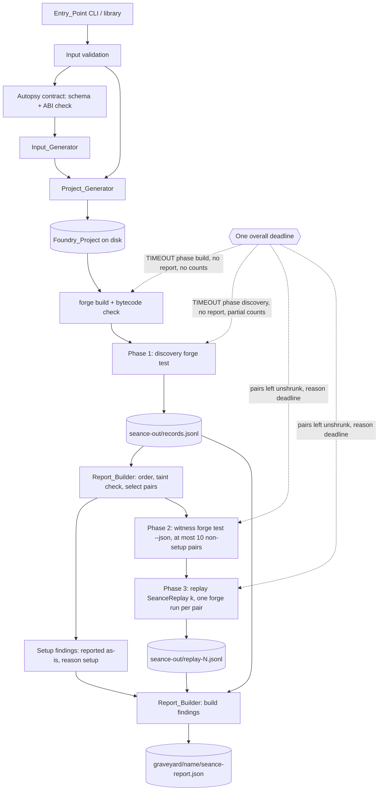
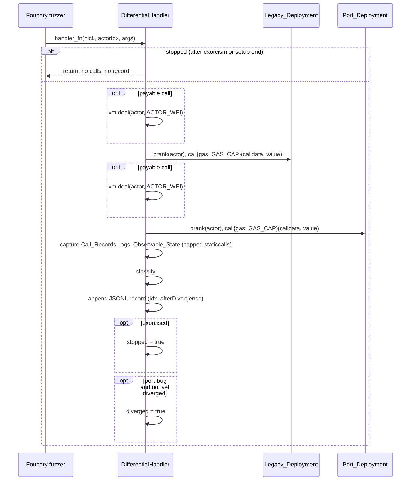

# Design Document

## Overview

The Séance_Engine lives in `engine/` and is the fourth stage of Exhume. For one legacy pre-0.8 contract and its deterministic 0.8 port, it generates a Foundry project, runs `forge`, and produces a JSON Séance_Report under `graveyard/<name>/`.

The design splits the work into two halves.

- **TypeScript half (pure, property-testable).** Autopsy input validation, targeted input generation, Foundry project generation, classification, taint computation, report building, finding selection, deadline arithmetic, and entry-point input validation. All of this is deterministic and runs in-process under vitest and fast-check.
- **Solidity half (generated, run by Foundry).** A generated `DifferentialHandler` deploys both bytecodes, sends identical calls, captures Call_Records, and appends one JSON line per call to a record file. A small `Classifier.sol` library mirrors the TypeScript classifier.

Key design decisions:

1. **Records, not invariant failures, drive counting.** Foundry stops an invariant campaign at the first failing invariant, which would truncate call counts. The discovery phase therefore has exactly one invariant function that can never fail on a correct handler, and runs with `invariant.shrink_run_limit = 0`. The handler writes one JSONL record per call via `vm.writeLine`. The engine derives counts, findings, and the BEC "within 2,000 calls" measurement from those records, after removing Foundry's post-campaign replay tail (decision 13).
2. **Three phases, one deadline.** Phase 1 (discovery) collects records. Phase 2 (witness shrinking) runs one invariant campaign per selected (function, Classification) pair and reads the shrunk handler-call sequence from `forge test --json`. Phase 3 (replay) re-executes each shrunk sequence in its own `SeanceReplay<k>` contract on a fresh `setUp` with recording on, and the engine builds the finding from the replay records. One overall deadline, set when the Entry_Point starts, is shared by `forge build` and all three phases. Only a deadline reached during `forge build` or discovery fails the run (`TIMEOUT` with `phase: "build"` or `phase: "discovery"`, no report). A deadline reached during witness or replay never fails the run: every pair not yet shrunk is reported with its original sequence, `unshrunk: true` and `unshrunkReason: "deadline"`, and the report is written.
3. **The handler is the only fuzz target.** The generated invariant test calls `targetContract(address(handler))` in `setUp` and excludes the two deployments, so Foundry never fuzzes the legacy or port contract directly (which would break the "identical calldata, sender in the Actor_Set" guarantee).
4. **Fresh state per sequence comes from Foundry.** Foundry reverts to the post-`setUp` state at the start of every invariant run, so each sequence starts with the same deployments (Requirement 5.4). Handler storage (`idx`, `stopped`, `diverged`) reverts with it. A record with `idx == 0` marks a new sequence. Records with `idx == -1` come from `setUp` and are written once per forge process.
5. **Classification has one specification and two implementations.** `classify` in TypeScript is the oracle and the report-side validator. `Classifier.sol` is the on-chain copy. A shared table of vectors in `engine/test/vectors/classification.json` runs against both (vitest and `forge test`).
6. **Event logs are compared at log level** with the emitter normalised to a `SELF` sentinel, so `emit` versus a legacy bare event call is irrelevant, and a dropped `emit` is a port bug.
7. **Divergence taint.** After the first `port-bug` in a sequence the handler keeps comparing and counting, but every later record carries `afterDivergence = true`. Tainted records count toward the Classification counts and never become findings (Requirements 5.5, 8.4).
8. **The handler cannot be starved or crashed by the deployments.** Every call into a deployment is a low-level call with a fixed gas cap (`GAS_CAP = 10_000_000`), and every state read is a capped `staticcall`. Neither can revert the handler.
9. **Both bytecodes load by artifact name.** `vm.deployCode("Legacy<Name>.sol:<Name>", ctorArgs)` and `vm.deployCode("Port<Name>.sol:<Name>", ctorArgs)` deploy with identical constructor arguments. Contract names inside the files are unchanged; only file names differ, so the two artifacts do not collide.

10. **Setup findings are reported as-is.** A finding whose first untainted record is a setup record (`idx == -1`) skips phases 2 and 3 and is reported with `unshrunk: true` and `unshrunkReason: "setup"`. Setup runs once per forge process and has no call sequence to shrink. The Dropped_Emit_Mutation is expected to surface this way: the token-share `transfer` in setup emits `Transfer` on the legacy side and not on the port side, so the `port-bug` finding is a setup finding. A `port-bug` in setup also taints every later record in every fuzz sequence (see Taint), because the two deployments have already diverged before the first fuzz call.
11. **forge-std is vendored, not fetched.** The Docker image contains one pinned forge-std checkout at `/opt/forge-std`, at the version recorded in `FORGE_STD_PIN` (`engine/src/seance/forge-std-pin.ts`, for example `v1.9.4`). The Project_Generator writes `remappings.txt` containing `forge-std/=/opt/forge-std/src/` and sets `allow_paths = ["/opt/forge-std"]` in `foundry.toml`. The generated project has no `lib/` directory, no git submodule, and no network access at build time. The pin value and the exact `remappings.txt` and `allow_paths` text are generator inputs, so a pin change changes the generated files (Property 2). The alternative, a minimal generated `StdInvariant` and `Vm` interface, was rejected because the handler and tests also need `Test`, `FuzzSelector`, and the `vm` cheatcode interface from the maintained library, and a hand-written copy would drift from the pinned Foundry version.

12. **Solc versions are pinned exactly.** Task 1.1 found that in Foundry 1.5.1 a bare version in `compilation_restrictions` (for example `version = "0.4.19"`) is read as the caret range `^0.4.19`, and forge then picks 0.4.26. The generator therefore writes `version = "=<legacy version>"` and an exact port `solc = "0.8.28"`.

13. **The record file ends with a replay tail, which the Report_Builder strips and verifies.** Task 1.2 found that Foundry 1.5.1 replays the final invariant run's calls once after the campaign. With `runs = 256` and `depth = 64` the record file therefore holds `runs * depth + depth` fuzz lines (16,448, plus the setup lines), and the last `depth` lines are an exact copy of the `depth` lines before them (probe: `runs = 10`, `depth = 5` gave 55). The Report_Builder keeps the first `INVARIANT_RUNS` sequences, counted by `idx == 0` starts, and treats every line after them as the replay tail. It verifies that the tail is an exact copy of the last kept sequence and fails with `SEANCE_FAILED` naming the first difference if not. The tail is never counted. The buffered `vm.writeFile` fallback was rejected: handler storage resets at the start of every run, so an in-memory buffer would be lost between runs, and buffering would not remove the duplicate run anyway. `vm.writeLine` and the scoped `fs_permissions` work as designed, and writes outside `./seance-out` are rejected.

14. **The witness result is read from `counterexample.Sequence[1]`.** Task 1.4 found the `forge test --json` shape: the top-level object is keyed by `"<file>:<contract>"`, each entry has `test_results`, and a failed invariant's `counterexample` is an object whose `Sequence` is a two-element array. `Sequence[0]` is the sequence length before shrinking, and `Sequence[1]` is the list of shrunk handler calls. A passing campaign has `counterexample: null`. `parseCounterexample` iterates the top-level keys and each entry's `test_results` rather than assuming a fixed file or contract key, keeps `Sequence[0]` as `originalLength`, and treats `null` as "no counterexample" (the pair is reported `unshrunk` with `unshrunkReason: "witness-not-failed"`).

15. **A project directory is never reused between séances.** Forge saves failing invariant sequences under `cache/invariant` and replays a saved failure on the next run instead of running a fresh campaign. A reused directory would therefore return a stale counterexample. Every séance generates its Foundry_Project in a fresh temporary directory. The discovery, witness, and replay phases share that directory only within the one séance. The directory is removed on success and kept on failure for debugging (see Error Handling), and is never reused by a later run, including a rerun of a failed séance. The Worker (a later spec) must follow the same rule.

Determinism expectation (to be confirmed by task 1.4, not yet verified): the same `--fuzz-seed` gives identical shrunk sequences when forge runs natively and when it runs in the Docker image. Until task 1.4 confirms this, the design relies on it only for repeatability of reports (Requirement 7.11), and the integration test that compares two runs of the same seed covers it.

Research notes (Foundry behaviour this design relies on, from Foundry docs): `compilation_restrictions` in `foundry.toml` pins a file path to a solc version, `vm.deployCode("File.sol:Contract", args)` deploys an artifact by name, `vm.recordLogs`/`vm.getRecordedLogs` capture logs per call, `vm.writeLine` requires `fs_permissions`, `targetContract`/`excludeContract`/`targetSelector` restrict invariant targets, invariant failures are shrunk by default bounded by `shrink_run_limit`, and `forge test --json` reports a `counterexample` call list for a failed invariant. These are the assumptions the Docker integration tests verify (see Known risks).

## Architecture





Repository placement:

```
engine/src/seance/
  entry.ts            # Entry_Point (CLI + library)
  inputs.ts           # entry input validation
  autopsy-contract.ts # schema validation, ABI cross-check
  input-generator.ts  # Targeted_Values
  project-generator.ts
  templates/          # Handler.sol, Classifier.sol, Seance.t.sol, Witness.t.sol, Replay.t.sol
  classify.ts
  taint.ts            # afterDivergence computation and cross-check
  report.ts           # build, select findings, validate, canonical serialize
  runner.ts           # forge process control, shared deadline
  forge-std-pin.ts    # FORGE_STD_PIN, remappings and allow_paths text, INVARIANT_RUNS, INVARIANT_DEPTH
  foundry-json.ts     # parser for `forge test --json` counterexamples
  schemas/            # autopsy-v1.schema.json, seance-report.schema.json
engine/test/seance/   # vitest + fast-check, forge tests for templates
graveyard/<name>/     # source, metadata, on-chain runtime code, seance-report.json
```

## Components and Interfaces

### Entry_Point (`entry.ts`)

```ts
export interface SeanceInput {
  contractName: string;            // 1..128 chars
  legacySource: string;            // non-empty, <= 1 MiB
  portSource: string;              // non-empty, <= 1 MiB
  autopsyReport: string;           // raw JSON text, <= 10 MB
  legacySolcVersion: string;       // 0.x.y, < 0.8.0
  legacyOptimizer: boolean;
  legacyOptimizerRuns?: number;    // 0..4294967295, required only when optimizer enabled
  onChainRuntimeCode: string;      // 0x hex
  constructorArgs?: string;        // ABI-encoded hex, default "0x"
  fuzzSeed?: string;
  timeoutSeconds?: number;         // default 300, one deadline for forge build and all three phases
}

export type SeanceError = { code: string; message: string; details?: unknown;
  phase?: "build" | "discovery";   // set on TIMEOUT only; TIMEOUT is raised only for these two phases
  partialCounts?: ClassificationCounts };  // TIMEOUT with phase "discovery" and HANDLER_FAULT only; never with phase "build"

export function runSeance(input: unknown, opts?: RunOptions): Promise<SeanceReport>; // rejects with SeanceError
```

The CLI wraps `runSeance`, prints the report or the structured error as JSON, and exits 0 on success and non-zero on any error. The Worker later calls `runSeance` unchanged.

Error codes: `MISSING_INPUT`, `INVALID_INPUT`, `AUTOPSY_REJECTED`, `SOLC_MISSING`, `BUILD_FAILED`, `BYTECODE_MISMATCH`, `TIMEOUT`, `HANDLER_FAULT`, `REPORT_WRITE_FAILED`, `ACCEPTANCE_FAILED`, `SEANCE_FAILED`.

### Input validation (`inputs.ts`)

`validateInput(raw): Result<SeanceInput, SeanceError>` collects every missing field (`MISSING_INPUT`) or every invalid field (`INVALID_INPUT`) in a single error. It also enforces the solc version rule (`/^0\.\d+\.\d+$/` and minor below 8) and the optimizer runs range. The Project_Generator reuses it so it never writes files for invalid inputs.

### Autopsy contract (`autopsy-contract.ts`)

```ts
export function parseAutopsyReport(text: string, legacyAbi: AbiFunction[]): Result<AutopsyReport, SeanceError>;
export function serializeAutopsyReport(r: AutopsyReport): string; // canonical key order
```

Check order, matching Requirement 11: size/empty/JSON parse, then `schemaVersion` present, then supported, then JSON-schema validation (all violations listed with JSON pointers, via Ajv with `allErrors`), then ABI function cross-check (all unknown function names listed). Supported versions: `["1"]`.

### Input_Generator (`input-generator.ts`)

Pure, `bigint` based.

```ts
export function generateTargets(report: AutopsyReport, abi: AbiFunction[]): TargetPlan;

export interface TargetPlan {
  sites: SiteTargets[];          // one entry per Arithmetic_Site
  seedSequences: SeedCall[][];   // each at most 10 calls
}
export interface SiteTargets {
  siteId: string;
  functionName: string;
  entries: TargetEntry[];        // 1..64
  unreachable: boolean;
}
// One entry is one atomic choice: all of its assignments are applied together.
export interface TargetEntry {
  assignments: { slot: ParamSlot; value: bigint }[];   // 1 for single, 2 for pair or array-length-times-value
}
export type ParamSlot =
  | { encoding: "static"; paramIndex: number; headOffset: number }
  | { encoding: "dynamicArrayLength"; paramIndex: number; headOffset: number };
```

**ParamSlot and dynamic arrays.** `headOffset` is `4 + 32 * (sum of head words of the preceding parameters)`, which is `4 + 32 * paramIndex` when every preceding parameter occupies one head word (all scalars and all dynamic types do). For a `static` slot, the value sits in the head word at `headOffset`. For a dynamic array parameter, the head word at `headOffset` holds an offset `o` relative to byte 4 of the calldata, the length is the word at `4 + o`, and the elements start at `4 + o + 32`. A `dynamicArrayLength` slot therefore targets the length word, not the head word. The slot is used for two things: (a) the handler maps each slot to a typed handler parameter (below), and (b) the Report_Builder reads the calldata value at the slot (following the offset for `dynamicArrayLength`) to attribute an exorcism to a site.

**Handler parameter mapping.** The handler does not take raw calldata. It takes typed parameters and builds the calldata with `abi.encodeWithSelector`, so the ABI encoder lays out heads and tails.

| ABI parameter | Handler parameters | Slot kind that targets it |
|---|---|---|
| `uintN`, `intN`, `bool`, `bytesN` | one `uint256` (cast and masked to the type) | `static` |
| `address` | `uint8 actorIdx`, resolved through `_addr` (Actor_Set plus `address(0)`) | none (not targeted) |
| `address[]` | `uint8 len` (bounded to 0..24) and `uint256 idxPack` (byte `j` is the actor index of element `j`) | `dynamicArrayLength` maps to `len` |
| other dynamic arrays | `uint8 len` and `uint256 seed`, element `j` is derived from `keccak256(seed, j)` | `dynamicArrayLength` maps to `len` |
| `bytes`, `string` | one `bytes` parameter | none |

**Paired targets.** A pair entry (`x * y`, `x ** y`) and an `arrayLenTimesValue` entry hold two assignments and are applied from a single pick, so both values are set together. For BEC's `cnt * _value`, one entry assigns `n` to the `dynamicArrayLength` slot of `_receivers` (handler `len`) and `ceil(M/n)` to the `static` slot of `_value`.

Rules (`M = 2^N`, `N` = bit width of the narrowest operand type):

| Site form | Entries produced |
|---|---|
| `x * k`, known `k > 1` | `x` in `[ceil(M/k)-2, ceil(M/k)+2]`, clamped to `[0, M-1]`, at most 5 |
| `a + b`, known `a` | `b` in `[M-1-a-2, M-1-a+2]`, clamped |
| `a - b`, known `a` | `b` in `[a-2, a+2]`, clamped |
| `x * y`, both unknown | pairs `(2^i, 2^(N-i))` with `i` chosen deterministically, always including `(2^(N/2), 2^(N/2))`, at most 64 |
| `x ** y` | pairs `(b, e)` with `b^e >= M` such as `(2, N)`, `(2, N+1)`, `(3, ceil(N/log2 3))`, at most 64 |
| array length `n` times value | for `n` in 2..24, `(n, ceil(M/n))` |

Seed sequences come from the Autopsy site's precondition hints (constructor-set balance, `approve`, prior `transfer`). A site with no resolvable seed is flagged `unreachable: true` and still gets entries (Requirements 6.10 to 6.12).

### Project_Generator (`project-generator.ts`)

```ts
export function generateProject(input: SeanceInput, plan: TargetPlan, abi: AbiFunction[]): ProjectFiles;
// ProjectFiles = Array<{ path: string; contents: string }> sorted by path, LF newlines, no timestamps
export function writeProject(dir: string, files: ProjectFiles): Promise<void>; // atomic: validate first, then write
```

The generator is a pure function with no clocks, randomness, or environment reads, so identical inputs give byte-identical files (Requirement 1.13). Output layout (`<Name>` is the contract name; the contract identifiers inside the files are unchanged):

```
foundry.toml
remappings.txt                   # forge-std/=/opt/forge-std/src/ (pinned, vendored in the image)
src/legacy/Legacy<Name>.sol      # pinned to legacy solc via version = "=<legacy version>"
src/port/Port<Name>.sol          # solc 0.8.28 (exact)
test/handler/DifferentialHandler.sol
test/handler/Classifier.sol
test/handler/Targets.sol         # target entries as constants
test/Seance.t.sol                # contract SeanceDiscovery: one invariant_discovery function
test/Witness.t.sol               # contracts Witness1..Witness10, one invariant_witness each (phase 2)
test/Replay.t.sol                # contracts SeanceReplay1..SeanceReplay10, one per shrunk sequence (phase 3),
                                 # each with its own setUp, output path, and test_replay
```

`foundry.toml` carries:

- a top-level port profile with an exact 0.8 solc version, `solc = "0.8.28"` (the constant `PORT_SOLC_VERSION`, never a range);
- `compilation_restrictions` entries whose `paths` are exactly the legacy source files (`src/legacy/Legacy<Name>.sol`) and whose `version` is exactly `=<legacy version>` with the leading `=` (for example `version = "=0.4.19"`). A bare version is never written, because Foundry 1.5.1 reads it as a caret range (decision 12);
- the optimizer settings for the legacy file only (a per-file additional compiler profile, omitting `optimizer_runs` when disabled);
- `fs_permissions = [{ access = "read", path = "./out" }, { access = "read-write", path = "./seance-out" }]`, which is enough for `vm.deployCode` to read artifacts and for `vm.writeLine` to write records, and nothing else;
- `gas_limit` set high enough (1,000,000,000) that two capped calls of 10,000,000 gas each, plus the handler's own work, never hit the block limit;
- `[invariant]` settings: `runs = 256` and `depth = 64` (the constants `INVARIANT_RUNS` and `INVARIANT_DEPTH` in `forge-std-pin.ts`, so a discovery campaign makes `INVARIANT_RUNS * INVARIANT_DEPTH` = 16,384 counted handler calls, and Foundry then replays the final run once, which writes `INVARIANT_DEPTH` further lines that are not counted, see decision 13), `fail_on_revert = true` (a handler revert is an engine fault, see Error Handling), and `shrink_run_limit = 0` for discovery. Witness runs override `shrink_run_limit` with Foundry's default through an environment variable. `report.runs` is `INVARIANT_RUNS`, the same constant the generator writes to `foundry.toml`, and `report.depth` is `INVARIANT_DEPTH`.
- `remappings.txt` with `forge-std/=/opt/forge-std/src/` and `allow_paths = ["/opt/forge-std"]`, so the project compiles against the pinned forge-std vendored in the Docker image (decision 11).

### Discovery invariant test (generated `Seance.t.sol`)

```solidity
contract SeanceDiscovery is Test {
    DifferentialHandler handler;
    function setUp() public {
        handler = new DifferentialHandler();
        handler.setOutputPath("seance-out/records.jsonl"); // before init, so setup records go to this file
        handler.init();                                   // deploys both, seeds, token shares
        targetContract(address(handler));                 // the only fuzz target
        excludeContract(address(handler.legacy()));       // never fuzz the deployments directly
        excludeContract(address(handler.port()));
        excludeSender(address(handler.legacy()));
        excludeSender(address(handler.port()));
        targetSelector(FuzzSelector({ addr: address(handler), selectors: handlerSelectors() }));
    }
    function invariant_discovery() public view {}         // the only invariant_ function
}
```

`handlerSelectors()` lists only the `handler_*` external functions. The handler's helpers are `internal` or `private`, so no other selector is reachable. Because `invariant_discovery` is the only function whose name starts with `invariant_`, and the engine passes `--match-contract SeanceDiscovery --match-test invariant_discovery`, no other campaign runs and no second invariant can fail and truncate the run. Foundry's senders for handler calls are irrelevant, because the handler pranks an Actor_Set address itself for every deployment call.

### DifferentialHandler (generated Solidity)

**Actor_Set.** `ACTORS = [DEPLOYER, A1, A2, A3]`, so the deployer/owner is an actor. `_addr(uint8 i)` returns `ACTORS[i % (ACTORS.length + 1)]`, with the extra index mapping to `address(0)`. Every `address` parameter and every `address[]` element is drawn this way, so address arguments come from the Actor_Set plus `address(0)` and nothing else. Senders come from `ACTORS[actorIdx % ACTORS.length]`, never `address(0)`.

**Setup (`init`).**

1. Under `vm.startPrank(DEPLOYER)`, deploy legacy with `vm.deployCode("Legacy<Name>.sol:<Name>", ctorArgs)` and port with `vm.deployCode("Port<Name>.sol:<Name>", ctorArgs)`, with byte-identical `ctorArgs`. Fund both with the same wei.
2. If the constructors differ in outcome, or both revert, write a record with `idx = -1` and set `stopped`. Otherwise continue.
3. **Token shares.** When the ABI has `transfer(address,uint256)` and `balanceOf(address)`, read the deployer's balance on the legacy deployment, set `share = balance / ACTORS.length`, and for each actor other than the deployer send `transfer(actor, share)` from the deployer through the normal differential path (same calldata and sender to both deployments, compared and classified). When the ABI lacks either function, this step is skipped.
4. Run the Input_Generator's seed sequences through the same differential path.

**Setup records are counted.** Every setup call (constructor, token share transfer, seed call) writes a record with `idx = -1`, is classified, and is included in `counts` and `totalCalls`. This happens once per forge process, not once per sequence (Foundry reverts to the post-`setUp` state), so it adds `ACTORS.length - 1` plus the seed calls (at most a few dozen) to the totals. Setup records are excluded from the budget ordinal: the "within 2,000 fuzz calls" measure for BEC counts only records with `idx >= 0`, so setup never consumes the call budget. Handler calls made while `stopped` produce no record and do not consume the budget either. A `port-bug` or `exorcised` setup record sets `stopped` in `setUp`, which Foundry preserves in the snapshot, so the séance ends with zero fuzz calls, consistent with Requirements 2.6 and 5.1. A setup `port-bug` taints the remaining setup records in the same way as a fuzz sequence. Because `diverged` is handler storage written during `setUp`, it is part of the snapshot that every fuzz sequence starts from, so after a setup `port-bug` every fuzz record carries `afterDivergence = true`. Findings whose first untainted record is a setup record skip phases 2 and 3 and are reported as-is with `unshrunkReason: "setup"` (decision 10). Their `precedingCalls` are the earlier setup calls in order.

**Handler functions.** One handler function per `nonpayable`/`payable` non-constructor ABI function, plus `handler_fallback_empty` and `handler_fallback_unknown` when the ABI has a `fallback`. Each takes `(uint256 pick, uint8 actorIdx, <mapped params from the table above>)`; payable functions add a `uint256 weiValue` that is bounded to `ACTOR_WEI` (a constant, `10_000 ether`).

**Target selection is deterministic in `pick`.**

```solidity
function _pickTarget(uint256 pick, uint256 n) internal pure returns (bool use, uint256 index) {
    uint256 h = uint256(keccak256(abi.encode(pick)));
    use = (n > 0) && (h % 2 == 0);        // even hash parity and targets exist: use a target
    index = n == 0 ? 0 : (h >> 1) % n;    // which entry
}
```

When `use` is true, the handler applies the whole entry (one or two assignments) to the typed parameters and ignores the fuzzed values for those slots. When `use` is false, all parameters come from fuzz input. Foundry does not draw `pick` uniformly (it biases toward small values and edge values such as 0, 1, and `type(uint256).max`), so the decision uses the parity of `keccak256(abi.encode(pick))`, which is balanced whatever the draw distribution. Targets are therefore chosen with probability 1/2 per draw in expectation, not as a hard per-draw guarantee. The selection function is deterministic and tested with fixed inputs.

**Differential call.** `_differential(selector, calldata, value)`:

1. If `stopped`, return without calls or records.
2. Set `vm.warp`/`vm.roll` to values computed only from `idx`, so replay reproduces them. Apply the same values to both calls.
3. For a payable call, `vm.deal(actor, ACTOR_WEI)`. Then `vm.prank(actor); vm.recordLogs();` and `(ok, ret) = legacy.call{value: value, gas: GAS_CAP}(calldata)`, and collect logs. For a payable call, `vm.deal(actor, ACTOR_WEI)` again before the port call, because the legacy call may have spent the sender's ether. Then repeat the prank, `recordLogs`, and call for the port with the same sender, value, calldata, and block context. Both sides therefore see the same sender balance. `vm.deal` is a cheatcode and does not consume the pending prank.
4. Read the Observable_State of each deployment with `staticcall{gas: GAS_CAP}`. A failed state read is encoded as a fixed sentinel value in that field and never reverts.
5. Classify with `Classifier.classify`. Compute `afterDivergence = diverged`. If the classification is `port-bug`, set `diverged = true` after computing the flag. If `exorcised`, set `stopped = true`.
6. When `SEANCE_RECORD != 0`, append the JSONL record containing `idx` and `afterDivergence` (the handler writes no ordinal), increment `idx`.

**Gas cap and handler faults.** Both deployment calls use `{gas: GAS_CAP}` with `GAS_CAP = 10_000_000`. A legacy `assert` (invalid opcode consumes all gas forwarded) therefore burns at most 10,000,000 gas and returns `ok = false` with empty return data, leaving the handler with enough gas to finish. Low-level `call` and `staticcall` never revert the caller, so the handler has no revert path of its own by design. A call that exhausts the cap on one side only is an ordinary divergence by the table (for example success versus empty revert is a `port-bug`), so the cap must stay large relative to legitimate gas use; this is a documented limitation. If the handler nevertheless reverts (an internal error, or the transaction running out of gas), `fail_on_revert = true` makes the discovery invariant campaign fail. The Runner classifies that as `HANDLER_FAULT`, discards the in-progress (last) sequence from the partial counts, writes no report, and returns the error to the caller. This is an engine error, never a classification.

**Observable_State** = `balance`, return data, normalised logs, all no-argument `view`/`pure` returns, and every one-address and two-address public mapping getter over the Actor_Set (so `allowed(owner, spender)` is covered, Requirement 10.4). Reverted calls get an empty log list (Requirement 3.11).

### Classifier (`classify.ts`, `Classifier.sol`)

```ts
export type Classification = "match" | "reason-modernised" | "exorcised" | "port-bug";
export interface CallRecord { success: boolean; data: string; logs: NormLog[]; state: ObservableState }
export function classify(legacy: CallRecord | undefined, port: CallRecord | undefined):
  { classification: Classification; invalidRecord: boolean; differingFields: string[] };
export function classifyConstructors(l: CtorOutcome, p: CtorOutcome): Classification;
```

Decision table:

| Legacy | Port | Condition | Result |
|---|---|---|---|
| missing or malformed | any | | `port-bug`, `invalidRecord` |
| revert | revert | data identical | `match` |
| revert | revert | data differs (including empty vs non-empty) | `reason-modernised` |
| success | revert | data equals `Panic(0x11)` encoding exactly | `exorcised` |
| success | revert | other data | `port-bug` |
| revert | success | | `port-bug` |
| success | success | return data, logs, and state all equal | `match` |
| success | success | any difference | `port-bug`, with `differingFields` |

`Panic(0x11)` encoding is `0x4e487b71` followed by the 32-byte word `0x11`, 36 bytes in total.

### Taint (`taint.ts`)

```ts
export function computeTaint(sequence: { classification: Classification }[], setupDiverged: boolean): boolean[];
// result[i] is true when setupDiverged, or when some j < i has sequence[j].classification === "port-bug"
// For the setup sequence itself, setupDiverged is false.
export function verifyTaint(records: OrderedRecord[]): Result<void, SeanceError>;
```

`verifyTaint` computes `setupDiverged` from the setup records (true when any setup record is a `port-bug`), recomputes the flag for every sequence, and compares it with the handler's `afterDivergence`. A mismatch means the handler and the engine disagree about the specification, and the run fails with `SEANCE_FAILED` naming the first mismatching record. `reason-modernised` and `exorcised` do not taint. `match` does not taint.

### Report_Builder (`report.ts`)

```ts
export function parseRecords(jsonl: string, runs: number): Result<OrderedRecord[], SeanceError>;
// assigns ordinal from line order to the kept records only; strips and verifies the replay tail; error is SEANCE_FAILED
export function buildReport(records: OrderedRecord[], meta: ReportMeta, shrunk: ShrinkOutcomes): SeanceReport;
export function selectFindingPairs(records: OrderedRecord[], cap: number):
  { setup: Pair[]; selected: Pair[]; overCap: Pair[] };
export type PairProgress = { witnessDone: Set<string>; replayDone: Set<string>; deadlineReached: boolean };
export function assignDispositions(sel: ReturnType<typeof selectFindingPairs>, progress: PairProgress): PairDisposition[];
// PairDisposition = { pair, outcome: "shrunk" | "unshrunk", unshrunkReason?: UnshrunkReason }
export type UnshrunkReason = "witness-not-failed" | "replay-mismatch" | "witness-cap" | "deadline" | "setup";
export function validateReport(r: unknown): Result<SeanceReport, SchemaViolation[]>;
export function serializeReport(r: SeanceReport): string;   // canonical key order, 2-space indent, trailing LF
export function parseReport(text: string): SeanceReport;
export function writeReportAtomic(path: string, text: string): Promise<void>; // temp file + rename
```

Behaviour:

- **Replay tail (decision 13).** `parseRecords(jsonl, runs)` is called with `runs = INVARIANT_RUNS` and works in this order:
  1. Discard a truncated last line. Split the lines into setup lines (every line before the first `idx == 0` line, which have `idx == -1`) and fuzz lines (from the first `idx == 0` line on). Number the sequences by `idx == 0` starts.
  2. If there are more than `runs` sequences, the tail is every line from the start of sequence `runs + 1` to the end of the file, and the kept lines are the setup lines plus the first `runs` sequences. Otherwise there is no tail and every line is kept.
  3. Verify the tail against the last kept sequence (sequence number `runs`) line by line. The tail passes only if it has exactly the same number of lines and, for each position, equal `idx`, `function`, `selector`, `calldata`, `sender`, `value`, both Call_Records (`success`, `data`, `logs`, `stateHash`, and `stateFields` where present), `classification`, `differingFields`, `invalidRecord`, and `afterDivergence`. The comparison is by position, not by sequence structure, so an extra `idx == 0` line inside the tail shows up as an `idx` difference. The first failing position gives a `SEANCE_FAILED` error whose message names the tail line's 1-based line number in `records.jsonl`, the field that differs (or `missing line` / `extra line` when the tail is shorter or longer than the copied sequence), and the expected and actual values.
  4. After a pass, the tail lines are dropped. They get no ordinal and no `fuzzOrdinal`, and they are not part of `counts`, `totalCalls`, `taintedCalls`, `sequenceResults`, `exorcisedAtIndex`, `verifyTaint`, finding selection, or the 2,000-call measure. The kept stream is identical to what a campaign without a replay would have written, so `totalCalls` is at most `setupCalls + INVARIANT_RUNS * INVARIANT_DEPTH`.
  - **Fewer than `runs` sequences, or exactly `runs`.** No tail check is applicable and nothing is stripped: every sequence is kept and counted, and `sequenceResults.total` is the number of sequences actually present. This covers a séance that ends in `setUp` (no fuzz lines at all), and a campaign that ended early. A campaign that fails early (handler fault, discovery timeout) never reaches the Report_Builder, because it ends in `HANDLER_FAULT` or `TIMEOUT` and no report is built. Those errors report `partialCounts` from the complete lines as described in the Runner section, with no replay stripping, because an interrupted discovery has no replay. If Foundry did replay a failed run in the `HANDLER_FAULT` case, the existing rule already drops the last (in-progress) sequence from those counts.
  - A kept `runs`-th sequence that is itself followed by a shorter or longer tail is not an exception: any line after sequence `runs` is a tail line and must match.
- `ordinal` is assigned here, 1-based, from the line order of the kept lines of `records.jsonl` (after the tail is removed). Setup records (`idx == -1`) receive ordinals like any other line but are excluded from the budget ordinal (`fuzzOrdinal`, counting only `idx >= 0`).
- Groups records by sequence (an `idx == 0` record starts a sequence; `idx == -1` records form the setup sequence) and ignores any record after an `exorcised` record in the same sequence (Requirement 5.3), recording `exorcisedAtIndex`.
- Counts every Classification, tainted or not, with zero for absent ones.
- **Findings come only from records with `afterDivergence = false`.** `selectFindingPairs` takes the first untainted record by ordinal for each (function, Classification) pair with Classification `exorcised` or `port-bug`, so a pair seen only after a divergence gives no finding (Requirement 8.4). Setup records have the lowest ordinals, so a pair whose first untainted record is a setup record (`idx = -1`) goes to `setup`: it is reported as-is with `unshrunkReason: "setup"`, skips phases 2 and 3, and does not count toward the cap. The remaining pairs are ordered `exorcised` first, then `port-bug`, each by first ordinal. The first `cap` of them (cap = 10) are `selected` for witness shrinking, and the rest are `overCap`. The cap therefore applies to fuzz pairs only, and setup findings never displace a fuzz pair.
- **Dispositions.** `assignDispositions` gives each pair exactly one outcome. `setup` pairs are `unshrunk/setup`. `overCap` pairs are `unshrunk/witness-cap`. For selected pairs: a pair whose witness campaign or replay did not complete before the deadline is `unshrunk/deadline` (this includes every pair for which no campaign was launched because the budget was already 0); a pair whose campaign passed is `unshrunk/witness-not-failed`; a pair whose replay Classification differs is `unshrunk/replay-mismatch`; otherwise it is `shrunk`.
- `chooseReported(original, shrunk, replayClass)` returns the shrunk sequence only if `replayClass` equals the original Classification, otherwise the original, flagged `unshrunk: true`.
- Attributes an Arithmetic_Site to an Exorcism when the exorcised call's function has exactly one site whose Targeted_Value appears in the calldata at the site's `ParamSlot` (following the offset for `dynamicArrayLength`), else `siteAttribution: "unattributed"`.
- Writes via temp file and rename so a write failure leaves any existing report unchanged (Requirement 7.2).

### Runner (`runner.ts`) and shared deadline

```ts
export interface Deadline { readonly at: number }                     // absolute ms timestamp
export function makeDeadline(startMs: number, timeoutSeconds: number): Deadline;
export function phaseBudgetMs(d: Deadline, nowMs: number): number;   // max(0, d.at - nowMs)
export function buildForgeArgs(phase: Phase, opts: ForgeOpts): string[];
```

The Entry_Point creates one `Deadline` when it starts (timeout default 300 s). `forge build`, discovery, every witness campaign, and every replay run each receive `phaseBudgetMs(deadline, now())` as their individual process timeout, so the total never exceeds the configured timeout. Time spent in `forge build` is therefore not available to later phases. The deadline has three different effects.

- **Build.** If the budget is 0 before `forge build` launches, or `forge build` exceeds its budget, the Runner sends SIGTERM and then SIGKILL so that `forge` stops within 5 seconds, and returns a `TIMEOUT` error carrying `phase: "build"`. The error has no `partialCounts`, because no séance records exist yet. No report is written, and the discovery phase is not started. The legacy solc check and the bytecode check are not subject to a separate budget. The bytecode check is a synchronous comparison that runs after a successful build, and if the deadline has passed by then, the Runner re-checks the budget before launching discovery and applies the discovery rule below.
- **Discovery.** If the budget is 0 before discovery launches, or discovery exceeds its budget, the Runner sends SIGTERM and then SIGKILL so that `forge` stops within 5 seconds, counts the complete lines of `records.jsonl` (discarding a truncated last line), and returns a `TIMEOUT` error carrying `phase: "discovery"` and `partialCounts`. Partial counts include every complete record written by discovery, including tainted ones. No report is written. `TIMEOUT` is raised only for build and discovery.
- **Witness and replay.** If the budget is 0 before a witness or replay run launches, the run is not launched. If a witness or replay run exceeds its budget, the Runner kills it the same way. In both cases the Runner stops launching further runs, sets `deadlineReached`, and returns the progress to the Report_Builder. Every selected pair that has not completed both its witness campaign and its replay is reported with its original sequence, `unshrunk: true` and `unshrunkReason: "deadline"`. Pairs that completed keep their shrunk findings. The report is written from the discovery records as usual, with `shrinking.deadlineReached = true`, and the run succeeds with exit status 0.

Replay records live in separate files (`seance-out/replay-<k>.jsonl`, one per `SeanceReplay<k>` contract) and never enter the counts.

`buildForgeArgs` produces, for each phase:

| Phase | Arguments |
|---|---|
| Discovery | `test --json --match-contract '^SeanceDiscovery$' --match-test invariant_discovery --fuzz-seed <seed>` with `SEANCE_RECORD=1` |
| Witness k | `test --json --match-contract '^Witness<k>$' --match-test invariant_witness --fuzz-seed <seed>` with `SEANCE_RECORD=0` |
| Replay k | `test --json --match-contract '^SeanceReplay<k>$' --fuzz-seed <seed>` with `SEANCE_RECORD=1`; the output path is set inside the contract's `setUp` |

`--match-contract` takes a regex, so the patterns are anchored: an unanchored `Witness1` would also match `Witness10`, and `SeanceReplay1` would match `SeanceReplay10`. Witness and replay runs execute one at a time, in pair order, each with the remaining budget. The Runner always works in a fresh temporary project directory created for this séance and never reuses one, because forge replays saved failures from `cache/invariant` and a stale cache would return an old counterexample (decision 15).

The Runner also checks that the legacy solc binary exists before `forge build` (a missing version yields `SOLC_MISSING` without building). The bytecode check strips the Metadata_Suffix (the CBOR section whose length is given by the last two bytes) from the runtime code of `out/Legacy<Name>.sol/<Name>.json` and from the On_Chain_Runtime_Code, and compares the rest.

### Phase 2: witness shrinking (`foundry-json.ts`)

For each selected (function, Classification) pair, the engine generates `Witness<k>` whose `setUp` is the same as discovery and additionally calls `handler.setWitness(selector, class)`. The handler sets `witnessHit = true` when it records a call with that function and Classification and `afterDivergence == false`. `invariant_witness()` asserts `!handler.witnessHit()`. The witness campaign runs with `SEANCE_RECORD=0` and Foundry's default shrinking.

The engine reads the result from `forge test --json` and never parses text output. `parseCounterexample` iterates the `"<file>:<contract>"` keys of the top-level object and each entry's `test_results`, and finds the `invariant_witness` result. For a failed campaign, `counterexample.Sequence[1]` is the shrunk list of handler calls (each with the handler `calldata` in hex and the sender), and `counterexample.Sequence[0]` is the sequence length before shrinking. `counterexample: null` means the campaign did not fail.

```ts
// foundry-json.ts
export interface HandlerCall { calldata: string; sender: string }
export type CounterexampleResult =
  | { found: true; originalLength: number; calls: HandlerCall[] }   // calls from Sequence[1], in order
  | { found: false };                                               // counterexample: null
export function parseCounterexample(json: unknown): Result<CounterexampleResult, SeanceError>;
```

A shape that matches neither form (no `invariant_witness` result, or `Sequence` not a two-element array) returns `SEANCE_FAILED` naming the missing part. `originalLength` is carried into the finding (see Data Models).

Outcomes per pair:

| Outcome | Result for the pair |
|---|---|
| Campaign fails with a counterexample | The shrunk handler calls (`Sequence[1]`) go to phase 3, and `Sequence[0]` is kept as `originalLength`. |
| Campaign passes (`counterexample: null`, the witness was not found again) | The original sequence from the discovery records is reported with `unshrunk: true`, `unshrunkReason: "witness-not-failed"`. |
| Pair is beyond the cap of 10 | No campaign runs. The original sequence is reported with `unshrunk: true`, `unshrunkReason: "witness-cap"`, and the report's `shrinking` block counts it as skipped. |
| Deadline reached (before launch, or the campaign is killed) | This pair and every later pair are reported with the original sequence, `unshrunk: true`, `unshrunkReason: "deadline"`. The run does not fail. |
| Pair is a setup finding | No campaign runs. Reported as-is with `unshrunkReason: "setup"`. |

The original (unshrunk) sequence is the untainted prefix of the discovery sequence up to and including the selected record, expressed as deployment calls (calldata, sender, value) taken straight from the records.

### Phase 3: replay

The generator emits one contract per shrunk sequence, `SeanceReplay<k>` (k = 1..10, matching the witness index), so no two replays share a record file. Each contract's `setUp` calls `handler.setOutputPath("seance-out/replay-<k>.jsonl")` before `handler.init()`, then runs the same setup as discovery (fresh deployments, recording on). Its single `test_replay` calls the handler with each shrunk handler calldata in order. The Runner executes the contracts one at a time (`--match-contract '^SeanceReplay<k>$'`), so a deadline kill affects only the replay in progress. Because the handler derives block time from `idx` and its state resets with `setUp`, the replay is deterministic. The shrunk handler calldata is baked into the generated contract after phase 2, so the generator runs once more for `Replay.t.sol` and writes only that file. The engine reads the replay records, takes the last record that has the selected function and `afterDivergence = false`, and compares its Classification with the original. If they are equal, the finding is built from the replay records: the failing call's calldata, sender, and value, and the preceding calls as the earlier records of the same sequence. If they differ, `chooseReported` falls back to the original sequence with `unshrunk: true`, `unshrunkReason: "replay-mismatch"`.

### BEC acceptance runner

`engine/src/seance/acceptance.ts` wraps `runSeance` and checks Requirement 9 and 10 conditions: an exorcism in `batchTransfer`, zero port bugs, first exorcism `fuzzOrdinal` at most 2,000, `_receivers` length 2..20, and replay confirmation. The `batchTransfer` finding must be shrunk and replay-confirmed (not `unshrunk`), which phase ordering supports because exorcised pairs are selected before port-bug pairs and always within the cap of 10 for BEC (setup pairs do not count toward the cap). A BEC acceptance run whose `batchTransfer` finding is `unshrunk` for any reason, including `deadline`, fails with `ACCEPTANCE_FAILED` naming the reason. It never overwrites `graveyard/bec/seance-report.json` on failure and returns the failing condition. The mutation variants (Planted_Port_Bug, Dropped_Emit_Mutation) are test-only ports produced by string-level edits in test fixtures, and must produce at least one `port-bug`.

- **Planted_Port_Bug** (`transferFrom` allowance not decremented) is not reached by setup, which only calls `transfer`. The finding comes from fuzzing, is shrunk and replay-confirmed, and has at most 3 preceding calls.
- **Dropped_Emit_Mutation** removes the `Transfer` emit from the port's `transfer` path. It is expected to surface in setup, at the token-share `transfer`. The acceptance check expects a `port-bug` finding for `transfer` with `unshrunkReason: "setup"`, whose differing fields include the Event_Logs, and it reports both Event_Logs lists. It does not expect a shrunk finding. Because the setup `port-bug` taints every fuzz record, the report holds no fuzz findings for this mutation, and the check does not require any.

## Data Models

### Autopsy_Report (schema v1)

```ts
interface AutopsyReport {
  schemaVersion: "1";
  contract: string;
  sites: ArithmeticSite[];
}
interface ArithmeticSite {
  id: string;
  function: string;
  operator: "+" | "-" | "*" | "**";
  operands: [Operand, Operand];
  location: { file: string; line: number; column: number };
  precondition?: { kind: "constructor-balance" | "approve" | "transfer"; hint?: string }[];
}
type Operand =
  | { kind: "known"; value: string /* decimal */; type: string }
  | { kind: "param"; name: string; type: string }
  | { kind: "arrayLength"; name: string; type: string }
  | { kind: "unknown"; type: string };
```

### Record line (JSONL, one per call, written by the handler)

```ts
interface RecordLine {
  idx: number;                   // position in sequence, 0-based; -1 for setup records
  function: string;
  selector: string;
  calldata: string;
  sender: string;
  value: string;                 // decimal wei
  legacy: CallRecordWire;
  port: CallRecordWire;
  classification: Classification;
  differingFields: string[];
  invalidRecord: boolean;
  afterDivergence: boolean;      // true on every record after the first port-bug in the same sequence
}
// Parsed by the engine. The handler never writes `ordinal`.
interface OrderedRecord extends RecordLine {
  ordinal: number;               // 1-based, assigned from line order of the JSONL file
  fuzzOrdinal?: number;          // 1-based among records with idx >= 0; absent for setup records
}
interface CallRecordWire { success: boolean; data: string; logs: NormLog[]; stateHash: string; stateFields?: Record<string,string> }
interface NormLog { emitter: "SELF" | string; topics: string[]; data: string }
```

`stateFields` is written only for records classified `port-bug`, to keep the file small.

### Séance_Report

```ts
interface SeanceReport {
  schemaVersion: "1";
  contract: string;
  seed: string;
  runs: number;                   // INVARIANT_RUNS, the value written to foundry.toml (256)
  depth: number;                  // INVARIANT_DEPTH (64)
  totalCalls: number;             // includes setup records
  counts: { match: number; "reason-modernised": number; exorcised: number; "port-bug": number };
  taintedCalls: number;           // records with afterDivergence = true; already inside counts
  setupCalls: number;             // records with idx = -1; already inside counts
  exorcisms: Finding[];
  portBugs: Finding[];
  sequenceResults: { total: number; endedExorcised: number; exorcisedAtIndex: number[] };
  shrinking: { witnessCap: 10; pairsFound: number; pairsSetup: number; pairsShrunk: number;
    pairsUnshrunk: number; pairsOverCap: number; deadlineReached: boolean };
  // pairsFound = pairsSetup + pairsShrunk + pairsUnshrunk + pairsOverCap
  // pairsUnshrunk counts witness-not-failed, replay-mismatch, and deadline
  unreachableSites: string[];
}
interface Finding {
  function: string;
  classification: "exorcised" | "port-bug";
  calldata: string;              // shrunk, hex (deployment calldata)
  sender: string;
  value: string;                 // decimal wei
  precedingCalls: { function: string; calldata: string; sender: string; value: string }[];
  originalLength?: number;       // pre-shrink handler-call count (counterexample.Sequence[0]); present only on shrunk findings
  unshrunk?: true;
  unshrunkReason?: "witness-not-failed" | "replay-mismatch" | "witness-cap" | "deadline" | "setup";
  site?: { id: string; location: { file: string; line: number; column: number } } | "unattributed";
  legacy?: CallRecordWire;       // port bugs only
  port?: CallRecordWire;         // port bugs only
  differingFields?: string[];
}
```

Invariants: the four counts sum to `totalCalls`; keys are serialized in a fixed order; numbers that exceed 2^53 are decimal strings; no finding is derived from a record with `afterDivergence = true`; every pair beyond the cap of 10 is reported with `unshrunk: true` and `unshrunkReason: "witness-cap"`, every setup pair with `"setup"`, and every pair not completed before the deadline with `"deadline"`, so the report always states what happened to it.

## Correctness Properties

*A property is a characteristic or behavior that should hold true across all valid executions of a system-essentially, a formal statement about what the system should do. Properties serve as the bridge between human-readable specifications and machine-verifiable correctness guarantees.*

### Property 1: Project generation is deterministic

*For any* valid séance input and target plan, generating the Foundry_Project twice produces the same set of relative paths with byte-identical contents.

**Validates: Requirements 1.13**

### Property 2: Generated project layout, foundry.toml, and artifact names

*For any* valid séance input, the generated file set includes `foundry.toml`, `src/legacy/Legacy<Name>.sol`, `src/port/Port<Name>.sol`, the handler, and the discovery test. The `foundry.toml` contains a Compilation_Restriction whose `paths` are exactly the legacy source files and whose `version` is exactly the string `=<legacy solc version>` (with the leading `=`, never a bare version), sets the port solc to an exact 0.8.x version (`0.8.28`, no range operator), sets the legacy optimizer to enabled with the given runs value (0 to 4,294,967,295) when enabled or to disabled with no runs value when disabled, and sets `fs_permissions` to read on `./out` and read-write on `./seance-out` only, sets `[invariant]` `runs = 256` and `depth = 64`, and contains the pinned forge-std wiring: a `remappings.txt` that is exactly `forge-std/=/opt/forge-std/src/` for the `FORGE_STD_PIN` version, and `allow_paths = ["/opt/forge-std"]`, so that changing `FORGE_STD_PIN` changes the generated files and the same pin always gives the same files. The generated project contains no `lib/` directory. The handler deploys the legacy contract with `vm.deployCode("Legacy<Name>.sol:<Name>", ...)` and the port with `vm.deployCode("Port<Name>.sol:<Name>", ...)`.

**Validates: Requirements 1.1, 1.2, 1.3, 1.4, 1.5, 1.7**

### Property 3: Input validation names every bad input and writes nothing

*For any* séance input in which a non-empty subset of fields is missing, or a non-empty subset is invalid (empty or over-length contract name, non-boolean optimizer, empty or over-1 MiB source, solc version not a 0.x.y below 0.8.0), validation returns an error whose message names exactly that subset, and the generator and Entry_Point start no run and write no files.

**Validates: Requirements 1.12, 12.4, 12.5**

### Property 4: Runtime bytecode comparison ignores only the metadata suffix

*For any* runtime code body and any two Metadata_Suffix values, the comparison reports equal, and *for any* two bodies that differ in at least one byte, it reports a mismatch.

**Validates: Requirements 1.8**

### Property 5: Handler coverage and parameter mapping match the ABI

*For any* ABI, the generated handler exposes exactly one handler function for each non-constructor function with `nonpayable` or `payable` mutability, maps every `address` parameter to a `uint8` actor index resolved over the Actor_Set plus `address(0)`, maps every `address[]` parameter to a bounded length and an index pack, and the observable-state reader includes every no-argument `view`/`pure` function and every address-keyed public mapping getter for each ordered pair of Actor_Set addresses.

**Validates: Requirements 3.3, 10.4**

### Property 6: The discovery test targets only the handler

*For any* valid séance input and ABI, the generated discovery test calls `targetContract` with the handler in `setUp`, excludes both deployments as contracts and as senders, restricts selectors to the handler's `handler_` functions, contains exactly one function whose name starts with `invariant_`, and the handler's non-`handler_` functions are not externally callable. The Actor_Set contains the deployer.

**Validates: Requirements 2.4, 3.1**

### Property 7: Log normalisation and comparison

*For any* two lists of raw logs in which the emitters equal the respective deployment address where they correspond, are otherwise identical, and have equal topics, data, and order, the normalised lists are equal. *For any* pair that differs in count, order, topics, data, or in a non-self emitter, the normalised lists are unequal. *For any* reverted call, the normalised log list is empty.

**Validates: Requirements 3.9, 3.10, 3.11**

### Property 8: Classification follows the decision table

*For any* pair of well-formed Call_Records, `classify` returns exactly one Classification, equal to the table oracle: both revert with identical data gives `match`; both revert with any differing byte (including empty versus non-empty) gives `reason-modernised`; legacy success and port revert data exactly equal to the 36-byte `Panic(0x11)` encoding gives `exorcised`; legacy success and any other port revert gives `port-bug`; legacy revert and port success gives `port-bug`; both succeed with equal return data, logs, and Observable_State gives `match`; both succeed with any difference (including a single `allowed` value) gives `port-bug` and lists the differing fields.

**Validates: Requirements 3.4, 3.8, 4.1, 4.2, 4.3, 4.4, 4.5, 4.6, 4.7, 4.8, 10.5**

### Property 9: Classification is pure and rejects malformed records

*For any* pair of Call_Records, calling `classify` twice returns equal results and leaves the inputs unmodified. *For any* pair in which a record is missing, malformed, or lacks a success or revert outcome, the result is `port-bug` with `invalidRecord` set.

**Validates: Requirements 4.9, 4.10**

### Property 10: Constructor outcome classification

*For any* pair of constructor outcomes, `classifyConstructors` returns `port-bug` when exactly one reverts, `match` when both revert with identical data, `reason-modernised` when both revert with differing data, and the séance ends without further calls in each of these three cases.

**Validates: Requirements 2.6, 2.7**

### Property 11: Exorcism truncates a sequence

*For any* stream of record lines containing sequences, the Report_Builder ends each sequence at its first `exorcised` record, counts and reports nothing after it in that sequence, records the index of the exorcised call and the prefix up to and including it in call order, marks the sequence as ending in an exorcised result, and keeps counting after `port-bug` and `reason-modernised` records. Sequences that start after the exorcism are unaffected.

**Validates: Requirements 5.1, 5.2, 5.3, 5.5, 5.6**

### Property 12: Divergence taint flags later records and excludes them from findings

*For any* sequence of records with arbitrary Classifications and any `setupDiverged` flag, `computeTaint(sequence, setupDiverged)` is true at every position when `setupDiverged` is true. When `setupDiverged` is false, it is true for exactly those positions that follow the first `port-bug` of the sequence, false for the first `port-bug` itself and for every earlier position, and false everywhere when the sequence contains no `port-bug` (so `reason-modernised`, `exorcised`, and `match` alone never taint). `setupDiverged` is true exactly when some setup record is a `port-bug`. *For any* record stream, tainted records are included in the Classification counts and in `taintedCalls`, and `selectFindingPairs` never selects a tainted record: a (function, Classification) pair whose records are all tainted produces no finding, and a pair with both tainted and untainted records is selected from its first untainted record by ordinal.

**Validates: Requirements 5.5, 8.4**

### Property 13: Multiplication targets overflow and wrap

*For any* bit width `N` in {8, 16, ..., 256} and any known factor `k > 1` with `k < 2^N`, the values produced for `x * k` are the clamped integers in `[ceil(M/k)-2, ceil(M/k)+2]` (at most 5, with `M = 2^N`), include `floor(M/k)` and `ceil(M/k)`, and at least one of them satisfies `x * k >= M` with `(x * k) mod M < k`.

**Validates: Requirements 6.2, 6.6, 6.13**

### Property 14: Addition and subtraction targets are windows around the boundary

*For any* bit width `N` and known operand `a` in `[0, M-1]`, the values for `a + b` are exactly the clamped integers in `[M-1-a-2, M-1-a+2]`, and the values for `a - b` are exactly the clamped integers in `[a-2, a+2]`, all within `[0, M-1]`.

**Validates: Requirements 6.3, 6.4, 6.6**

### Property 15: Unknown-operand multiplication pairs overflow and wrap

*For any* bit width `N` (even), the pairs produced for `x * y` with both operands unknown number between 1 and 64, include `(2^(N/2), 2^(N/2))`, and each pair satisfies `x * y >= M` and `(x * y) mod M < min(x, y)`.

**Validates: Requirements 6.5, 6.6**

### Property 16: Array length times value pairs overflow and wrap

*For any* bit width `N` and any array length `n` from 2 to 24, the generator produces the pair `(n, ceil(M/n))`, and each produced pair satisfies `n * value >= M` and `(n * value) mod M < n`.

**Validates: Requirements 6.8, 6.14**

### Property 17: Every site gets bounded entries with correct slots, paired values stay together

*For any* valid Autopsy_Report and ABI, every Arithmetic_Site has between 1 and 64 target entries, each entry's slot `headOffset` equals `4 + 32 * (head words of the preceding parameters)` (which is `4 + 32 * paramIndex` for scalar and dynamic-type predecessors), a slot targeting the length of a dynamic array has encoding `dynamicArrayLength` and one targeting a scalar has encoding `static`, every pair or array-length-times-value entry carries both of its assignments in a single entry (so one pick sets both), every seed sequence has at most 10 calls, and a site with no resolvable seed is flagged unreachable while still receiving entries. An empty report yields an empty plan.

**Validates: Requirements 6.1, 6.7, 6.8, 6.10, 6.11, 6.12**

### Property 18: Autopsy report round trip

*For any* valid Autopsy_Report, `parse(serialize(r))` deeply equals `r`, and serializing the parsed value yields a document equal to the first serialization.

**Validates: Requirements 11.9**

### Property 19: Autopsy rejection is ordered and exhaustive

*For any* Autopsy_Report text, the engine checks emptiness, size, and JSON syntax first, then `schemaVersion`. A missing or unsupported version produces an error naming it, and no schema errors are reported in that case. For a supported version it reports every schema violation with its location, then every function name absent from the ABI. A valid report yields every site available to the generator. In every rejection case, no séance inputs are generated.

**Validates: Requirements 11.2, 11.3, 11.4, 11.5, 11.6, 11.7, 11.8, 11.10**

### Property 20: Report round trip and schema validity

*For any* valid Séance_Report, the serialized document validates against the report schema, and serialize, parse, serialize yields a byte-identical document.

**Validates: Requirements 7.8, 7.9**

### Property 21: Report counts are complete and consistent, ordinals follow line order

*For any* stream of record lines, `parseRecords(jsonl, runs)` assigns ordinals 1..n in line order of the kept lines (discarding a truncated last line), the built report has all four Classification keys (zero when absent), the counts sum to `totalCalls`, every call has exactly one Classification, setup records (`idx = -1`) are inside the counts and inside `setupCalls`, and `fuzzOrdinal` is assigned only to records with `idx >= 0`. Each Exorcism or Port_Bug finding includes function name, calldata hex, sender, decimal `value`, and a preceding-call list (empty when none are needed). Each Port_Bug finding also includes both Call_Records with their logs. `verifyTaint` accepts a stream exactly when every `afterDivergence` flag equals the recomputed taint. *For any* stream of setup lines and exactly `runs` sequences, and *for any* generated replay tail that is an exact copy of the last of those sequences appended after it, the parsed records, ordinals, `fuzzOrdinal` values, `counts`, `totalCalls`, `taintedCalls`, `setupCalls`, `sequenceResults`, findings, and the `fuzzOrdinal` of the first exorcism (the 2,000-call measure) all equal those obtained from the same stream without the tail, and `totalCalls` is at most `setupCalls + runs * depth`. *For any* such stream with fewer than or exactly `runs` sequences and no tail, nothing is stripped and every sequence is counted. *For any* tampered tail (one field of one tail line changed, a tail line dropped, a line added, or an `idx == 0` line inserted in the tail), `parseRecords` returns a `SEANCE_FAILED` error whose message names the 1-based line number of the first differing tail line and the differing field (or `missing line` / `extra line`), and no report is built.

**Validates: Requirements 7.3, 7.4, 7.7, 7.10, 12.2**

### Property 22: One finding per function and class, cap, and unshrunk fallback

*For any* set of failing sequences, the report contains at most one finding per (function, Classification) pair for `exorcised` and `port-bug`. *For any* record stream, `selectFindingPairs` puts every pair whose first untainted record is a setup record (`idx = -1`) into `setup`, reported with `unshrunk: true` and `unshrunkReason: "setup"`, never sent to phases 2 and 3, and never counted toward the cap. Among the remaining pairs it selects at most 10 for witness shrinking, orders `exorcised` pairs before `port-bug` pairs (each by first ordinal), and reports every pair beyond the cap with `unshrunk: true` and `unshrunkReason: "witness-cap"`, with `pairsFound = pairsSetup + pairsShrunk + pairsUnshrunk + pairsOverCap`. *For any* original sequence, shrunk sequence, and replay Classification, `chooseReported` returns the shrunk sequence when the replay Classification equals the original, and otherwise the original sequence marked `unshrunk` with the original Classification. A pair whose witness campaign did not fail is reported unshrunk with its original sequence.

**Validates: Requirements 7.12, 8.1, 8.3, 8.4, 8.5, 8.6, 8.7**

### Property 23: Partial counts on discovery timeout and handler fault, none on build timeout

*For any* record stream, optionally ending in a truncated line, the partial counts after a discovery timeout equal the Classification counts of all complete lines, and the partial counts after a handler fault equal those of all complete lines with the records of the last (in-progress) sequence removed. In both cases the counts sum to the number of records included, and no replay-tail stripping is applied (an interrupted discovery has no replay). *For any* `TIMEOUT` error built for the phase `build`, the error has no `partialCounts` field, and *for any* `TIMEOUT` error built for the phase `discovery`, it has one.

**Validates: Requirements 12.8, 12.9, 12.10**

### Property 24: Fuzz seed is passed through unchanged

*For any* fuzz seed string and any phase (discovery, witness, replay), the forge command line built by the Runner contains that seed unchanged as its `--fuzz-seed` argument.

**Validates: Requirements 12.12**

### Property 25: One shared deadline bounds build and all phases

*For any* timeout `T` seconds (default 300 when unset), any start time, and any ordered sequence of start times for the build, discovery, witness, and replay runs within the run, `phaseBudgetMs` returns `max(0, deadline - now)`, never exceeds `T` in milliseconds, never increases as time passes, and returns 0 once the deadline has passed, so the sum of time actually granted across the build, discovery, witness, and replay runs does not exceed `T`. The `forge build` run draws its budget from the same deadline as the later phases, so time spent building reduces what discovery receives.

**Validates: Requirements 12.7, 12.8, 12.9, 12.10, 12.11**

### Property 26: A deadline in witness or replay leaves pairs unshrunk and never fails the run

*For any* set of selected, setup, and over-cap pairs and any progress state (the set of pairs whose witness campaign and replay completed, and the `deadlineReached` flag), `assignDispositions` gives every pair exactly one disposition. Setup pairs are `unshrunk/setup`, over-cap pairs are `unshrunk/witness-cap`, and every selected pair that is not in both completed sets is `unshrunk/deadline` when `deadlineReached` is true. Pairs that completed keep their witness-not-failed, replay-mismatch, or shrunk outcome. When `deadlineReached` is false, no pair has the reason `deadline`. The resulting report counts satisfy `pairsFound = pairsSetup + pairsShrunk + pairsUnshrunk + pairsOverCap`, and `shrinking.deadlineReached` equals the flag. A `TIMEOUT` error is possible only when the deadline is reached during build or discovery.

**Validates: Requirements 7.12, 8.1, 8.3, 8.5, 8.6, 8.7, 12.11**

## Error Handling

| Condition | Code | Behaviour |
|---|---|---|
| Missing inputs | `MISSING_INPUT` | One error naming all missing inputs; no run, no files. |
| Invalid inputs | `INVALID_INPUT` | One error naming all invalid inputs; no run, no files. |
| Autopsy empty, non-JSON, over 10 MB | `AUTOPSY_REJECTED` | Message states which condition; no séance inputs. |
| Autopsy `schemaVersion` missing, unsupported, schema violations, unknown functions | `AUTOPSY_REJECTED` | Details list every violation or function. |
| Legacy solc absent | `SOLC_MISSING` | Names the version; `forge build` not invoked. |
| `forge build` non-zero | `BUILD_FAILED` | Full compiler output and each failing source file. |
| Runtime code mismatch | `BYTECODE_MISMATCH` | Reports both code hashes; séance not run. |
| Constructor outcome differs or both revert | n/a | Classified per Requirement 2; the handler is `stopped`, and the séance ends with the setup records only. |
| Deadline reached during `forge build` | `TIMEOUT` | One deadline for the whole run, started before the build. SIGTERM, then SIGKILL, so `forge` stops within 5 s. The error carries `phase: "build"` and no `partialCounts`. No report is written and discovery does not start. |
| Deadline reached during discovery | `TIMEOUT` | Same deadline. SIGTERM, then SIGKILL, so `forge` stops within 5 s. The error carries `phase: "discovery"` and `partialCounts` from the complete lines of `records.jsonl`. No report is written. `TIMEOUT` is raised only for build and discovery. |
| Deadline reached during witness or replay | n/a | Not an error. The running `forge` process is killed within 5 s, no further runs launch, and every pair not yet shrunk is reported with its original sequence, `unshrunk: true`, `unshrunkReason: "deadline"`. The report is written with `shrinking.deadlineReached = true`, and the run exits 0. |
| Finding from a setup record | n/a | Not an error. Phases 2 and 3 are skipped for it, and it is reported with `unshrunk: true`, `unshrunkReason: "setup"`. |
| Handler reverts (internal error, out of gas) | `HANDLER_FAULT` | `fail_on_revert = true` fails the discovery invariant. The error carries `partialCounts` with the in-progress sequence removed, and no report is written. Deployment reverts and gas exhaustion inside the capped calls are not faults; they are classified normally. |
| Handler/engine taint disagreement | `SEANCE_FAILED` | `verifyTaint` names the first mismatching record. |
| Replay tail is not an exact copy of the last kept sequence | `SEANCE_FAILED` | Raised by `parseRecords`. The message names the 1-based line number in `records.jsonl` of the first differing tail line, the differing field (or `missing line` / `extra line`), and the expected and actual values. No report is written. Records with fewer than `INVARIANT_RUNS` sequences have no tail and never raise this error. |
| Witness campaign passes (no counterexample) | n/a | Not an error. The pair is reported with the original sequence, `unshrunk: true`, `unshrunkReason: "witness-not-failed"`. |
| Replay Classification differs from original | n/a | Not an error. The original sequence is reported with `unshrunk: true`, `unshrunkReason: "replay-mismatch"`. |
| More than 10 (function, Classification) pairs | n/a | Not an error. Pairs beyond the cap are reported with `unshrunk: true`, `unshrunkReason: "witness-cap"` and counted in `shrinking.pairsOverCap`. |
| Report write failure | `REPORT_WRITE_FAILED` | Atomic temp-and-rename; existing report unchanged. |
| BEC or mutation acceptance failure | `ACCEPTANCE_FAILED` | Names the failing condition; existing `graveyard/bec/` report unchanged; non-zero exit. |
| Any other failure | `SEANCE_FAILED` | Structured error with message; non-zero exit. |

If the Foundry run leaves a truncated last line in `records.jsonl` (for example after a kill), the Report_Builder discards that line and continues. The temporary project directory is removed on success and kept on failure for diagnosis. A kept directory is never reused by a later run, so each séance starts with an empty `cache/invariant`.

## Testing Strategy

**Dual approach.** vitest example tests cover specific cases and integration points. fast-check property tests (library: `fast-check`, not hand-rolled) cover Properties 1 to 26. Each property is implemented as one `fc.assert(fc.property(...), { numRuns: 100 })` test or more runs, with a comment in the form `Feature: seance-engine, Property <n>: <title>`. Generators use `bigint` arbitraries for the 2^N boundaries, and also bias toward boundary values (0, 1, `M-1`, `M/2`, `k` near powers of two). Record streams for Properties 11, 12, 21, 22, 23, and 26 (Property 21 also appends a generated replay tail, an exact copy of the last of `runs` sequences, and a tampered variant) (which also draw a random progress state and `deadlineReached` flag) are generated as arrays of sequences with arbitrary Classifications, function names, and optional truncated last lines.

**Property tests (vitest, no forge needed):** Properties 1 to 26 above. The classification oracle for Property 8 and the taint oracle for Property 12 are plain lookup or scan implementations that are independent of `classify` and `computeTaint`.

**Example and edge-case tests (vitest):**
- Generated handler uses `call{gas: GAS_CAP}` and `staticcall{gas: GAS_CAP}` for every deployment call and state read (item: gas cap), and contains no non-low-level call into a deployment.
- Fallback handlers exist when the ABI has a `fallback` (3.6).
- Token-share setup is emitted only when the ABI has both `transfer(address,uint256)` and `balanceOf(address)`.
- `parseCounterexample` against fixtures captured from the pinned Foundry version (`engine/test/fixtures/forge-json/failing.json` and `passing.json`): the failing fixture gives `calls` from `Sequence[1]` and `originalLength` from `Sequence[0]`, the passing fixture (`counterexample: null`) gives `found: false`, a fixture with a different `"<file>:<contract>"` key still parses, and a malformed `Sequence` gives `SEANCE_FAILED`.
- Two séances for the same input use two different project directories, and the Runner never starts forge in a directory that already contains `cache/invariant`.
- Mock-runner tests for `SOLC_MISSING` with no `forge build` call (1.10), `BUILD_FAILED` carrying output (1.11), `BYTECODE_MISMATCH` stopping before the séance (1.9), timeout default of 300 s (12.7), a deadline during `forge build` giving `TIMEOUT` with `phase: "build"`, no `partialCounts`, no report written, and no discovery process launched (12.8, 12.9), a zero budget before `forge build` launching no process and giving the same error, a build that consumes most of the budget leaving discovery only the remainder, a deadline during discovery giving `TIMEOUT` with `phase: "discovery"` and partial counts (12.8, 12.10), a deadline during witness and a deadline during replay each giving a written report, exit status 0, `shrinking.deadlineReached = true`, and `unshrunkReason: "deadline"` for every unfinished pair while finished pairs stay shrunk, a zero budget before the witness phase launching no `forge` process, `HANDLER_FAULT` on a failed discovery invariant, and structured errors for other failures (12.6).
- Witness-not-failed, replay-mismatch, over-cap, deadline, and setup each produce the documented `unshrunkReason` in the report. A setup finding launches no witness or replay run.
- `--match-contract` patterns are anchored, so `Witness1` and `SeanceReplay1` do not select `Witness10` and `SeanceReplay10`.
- The generated `Replay.t.sol` has one contract per shrunk sequence, each setting its own output path before `init`, and no two contracts share a path.
- `report.runs` and `report.depth` equal the `runs` and `depth` written to `foundry.toml`.
- Report write failure leaves an existing report intact (7.2), site attribution (including a `dynamicArrayLength` slot) and the `unattributed` marker (7.5, 7.6), CLI exit codes (12.3), failed acceptance returns a non-zero status (10.6, 10.8).
- Autopsy edge cases: empty text, invalid JSON, a document just over 10 MB (11.10).

**Forge tests (Solidity, in the Docker image):**
- `Classifier.sol` runs the shared vectors in `engine/test/vectors/classification.json` and matches the TypeScript classifier.
- `_pickTarget` is tested deterministically with fixed inputs. The test computes `h = uint256(keccak256(abi.encode(pick)))` on its own side and uses it to choose inputs: for a fixed list of picks it asserts that `h` even with `n > 0` returns `use = true` and `index = (h >> 1) % n`, that `h` odd returns `use = false`, and that `n == 0` returns `use = false` for any `pick`. The list is checked to contain picks of both parities (including 0, 1, and `type(uint256).max`). The rate of about 1/2 follows from the hash parity and does not depend on Foundry's draw distribution, and no statistical test is used.
- A payable fixture whose legacy and port versions both consume the sender's ether: after the call, the `vm.deal` calls before each side give both the same pre-call sender balance, observed through a `msg.sender.balance` read inside the fixture.
- `_addr` resolves every index into the Actor_Set or `address(0)`, and the `address[]` builder produces the expected addresses from `(len, idxPack)`.
- Handler tests on small fixture contracts check identical constructor args, funding, deployer, sender in the Actor_Set, matching timestamp and block, one Call_Record per deployment, reverts recorded and the run continuing, no calls after `stopped`, a legacy `assert` (invalid opcode) fixture that returns control to the handler within the gas cap, the handler setting `afterDivergence` only after the first `port-bug`, and the equal token shares (2.1 to 2.5, 3.1, 3.2, 3.5, 3.7, 5.4, 5.5).

**Integration and acceptance tests (linux/amd64 Docker image with Foundry and solc 0.4.19; not run in CI by default):**
- Build with both compilers in a single `forge build` (1.6), including loading both artifacts by `File.sol:Contract` name.
- Record file shape: the raw `records.jsonl` of a discovery run holds `INVARIANT_RUNS * INVARIANT_DEPTH + INVARIANT_DEPTH` fuzz lines (16,448) and the last `INVARIANT_DEPTH` lines are identical to the previous `INVARIANT_DEPTH` lines. The report's `totalCalls` excludes the tail.
- BEC: exorcism in `batchTransfer` within 2,000 fuzz calls (setup records and the replay tail excluded from the budget), zero port bugs, shrunk calldata with `_receivers` length in 2..20, replay confirms, report stored in `graveyard/bec/` (Requirement 9). The token-share setup effect on BEC's counts is checked here: `setupCalls` equals the actor count minus one plus seed calls.
- Planted_Port_Bug: at least one `port-bug` attributed to `transferFrom` with at most 3 preceding calls (Requirement 10.1 to 10.3).
- Dropped_Emit_Mutation: a `port-bug` finding for `transfer` with `unshrunkReason: "setup"` (it surfaces at the token-share transfer in setup), whose differing field is the Event_Logs, with both Event_Logs lists reported (10.7). The check does not expect a shrunk finding.
- Same seed gives the same counts across two runs (7.11). A timeout during `forge build` stops `forge` within 5 s and returns `TIMEOUT` with `phase: "build"` and no partial counts (12.8, 12.9). A timeout during discovery stops `forge` within 5 s and returns `TIMEOUT` with `phase: "discovery"` and partial counts (12.8, 12.10). A deadline during witness or replay stops `forge` within 5 s and still writes a report with `unshrunkReason: "deadline"` for the unfinished pairs. Shrinking and replay behaviour (8.1, 8.2) are checked by the BEC run, and the witness campaign does not fail for an over-cap pair.

**Not covered by property tests, and why:** criteria that depend on real `forge`, solc, or the EVM (Requirements 1.6, 2, 3.1 to 3.7, 5.4, 7.11, 8.1, 8.2, 9, 10.1 to 10.3, 10.7, 12.8 to 12.11 for real process kills) are checked by the forge and integration tests above, because the behaviour is fixed by Foundry's runtime and 100 iterations would add cost without finding more bugs.

**Known risks.** The design assumes the following, and the first Docker integration test verifies each:

- `vm.writeLine` works inside invariant runs, with `fs_permissions` scoped to `./out` (read) and `./seance-out` (read-write) (verified in task 1.2, and writes outside `./seance-out` are rejected). Observed in Foundry 1.5.1: after the campaign Foundry replays the final run's calls once, so the record file holds `runs * depth + depth` fuzz lines (16,448 for 256 and 64; probe `runs = 10`, `depth = 5` gave 55), and the last `depth` lines copy the `depth` lines before them. Decision: keep `vm.writeLine`, and have the Report_Builder keep the first `INVARIANT_RUNS` sequences and verify the rest as an exact replay tail (decision 13). If a Foundry version changes the replay behaviour (no replay, a replay of a different length, or a replay of a failed run), the tail check fails with `SEANCE_FAILED` or finds no tail, and the Docker record-file-shape test catches it.
- Handler storage (`idx`, `stopped`, `diverged`) reverts to its post-`setUp` value at the start of every invariant run, and `setUp` runs once per forge process.
- `forge test --json` exposes the failed invariant's `counterexample.Sequence` as `[originalLength, calls]` (null when the campaign passes), in the pinned Foundry version (decision 14). `foundry-json.ts` isolates this format so a version change breaks one parser and its fixtures.
- Forge replays saved failures from `cache/invariant`, so a reused project directory would return a stale counterexample. The Runner and the future Worker must use a fresh directory per séance (decision 15).
- The same `--fuzz-seed` is expected to give identical shrunk sequences natively and in Docker. Task 1.4 is to confirm this. If it does not hold, only native-versus-Docker comparisons are affected, and reports remain repeatable within one environment.
- The per-file legacy optimizer profile is selected by `compilation_restrictions` together with `additional_compiler_profiles`, and `vm.deployCode("Legacy<Name>.sol:<Name>", ...)` resolves the right artifact when the port has the same contract name in a different file.
- Foundry 1.5.1 reads a bare `compilation_restrictions` version as a caret range (`0.4.19` becomes `^0.4.19` and forge picks 0.4.26), so the generator must write `=<legacy version>` and an exact port solc.
- If a Foundry version changes the artifact path layout, Property 2 will not catch it, but the BEC integration build will.
- The pinned forge-std at `/opt/forge-std` must resolve through `remappings.txt` and `allow_paths` for files outside the project root. The Docker build test compiles a generated project to check this, and checks that the image's forge-std matches `FORGE_STD_PIN`.
- **Wall-clock time with recording on.** Discovery makes 256 x 64 = 16,384 counted handler calls, and Foundry's post-campaign replay of the final run adds 64 more recorded calls (16,448 lines in total, not counted in the report). Each call runs two deployment calls, a state read for each side, and one `vm.writeLine`, and every `vm.writeLine` goes through the `fs_permissions` check and a file append. Together with `vm.recordLogs` this may exceed the 300 s default timeout on slower machines, and a discovery timeout fails the run, and a slow first-time `forge build` (two solc versions, cold cache) also draws on the same deadline and leaves less time for discovery. The first Docker run measures the time per call and the total. Mitigations, in order: (1) keep `runs = 256` and `depth = 64` and raise the default timeout for graveyard runs; (2) not available: buffering records in handler memory and writing them with `vm.writeFile` was rejected, because handler storage resets at the start of every run so the buffer would be lost, and it would not remove the duplicate replay run (decision 13); (3) write `stateFields` only for `port-bug` records (already the case) and drop the per-call state read when the call reverted on both sides; (4) lower `depth` while keeping `runs`, which must stay equal to the value reported in `report.runs` and `report.depth`.
- The first witness campaign also runs 256 x 64 handler calls with recording off, per pair, and up to 10 pairs, so the shared deadline is more likely to cut witness and replay than discovery. This is the reason a deadline there is a reported outcome (`unshrunkReason: "deadline"`) and not an error.
